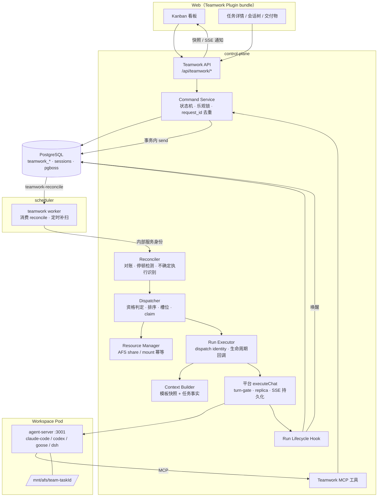
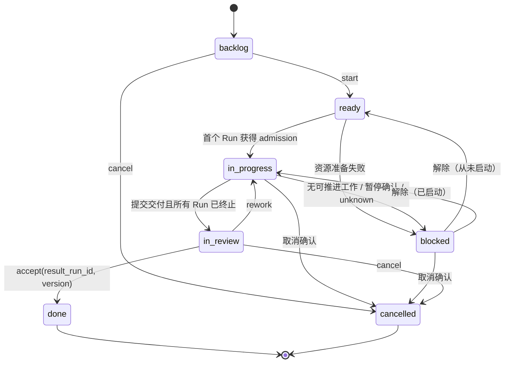
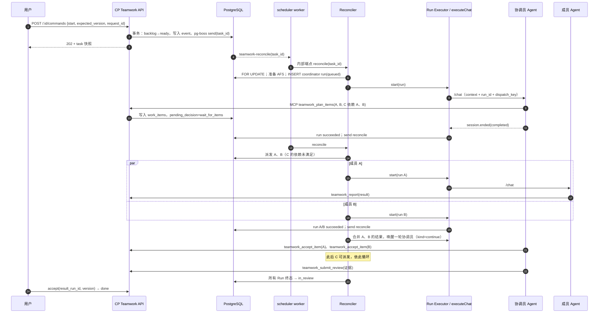
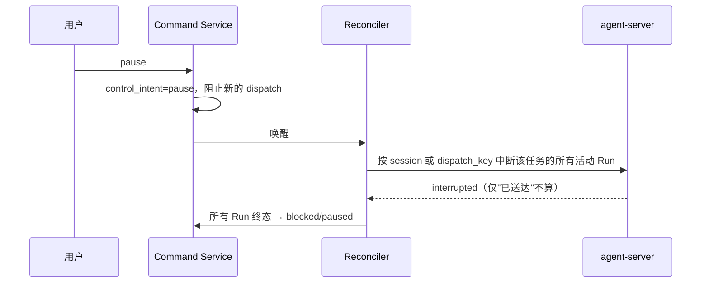
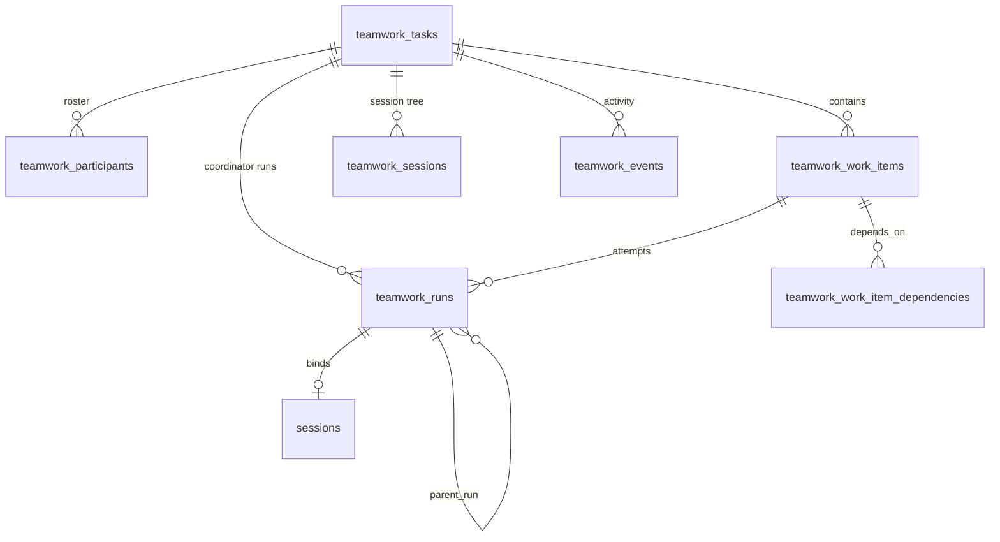

# QAP Teamwork 改造架构设计（借鉴 Symphony）

状态：已被 `docs/teamwork-v2/`（V2.1）吸收，仅保留作背景参考；冲突以 V2.1 为准。日期：2026-09-28。
代码基线：QAP `80361d0`（main）；Symphony `8001b52`。

## 0. 文档定位

本文是 Teamwork 改造的**架构视图**：分层、组件、关键流程、改造清单与路线。
产品交互、七列 Kanban、Plugin 生命周期、API 字段级契约、验收矩阵见同目录 `teamwork-technical-proposal.md`（下称《技术方案》），本文不重复，只在必要处引用章节号。两份文档的状态名、表名保持一致。

## 1. 背景与目标

### 1.1 现状一句话

QAP 已有 Teamwork 雏形：一个任务 = 协调员 Workspace + 成员 roster + AFS 共享目录；协调员 LLM 通过 `call_agent` 自由调用成员。它是**对话驱动**，没有任务状态、没有调度器、成员执行绕过平台执行链路。

### 1.2 Symphony 给我们的启发

Symphony 把"盯着 Agent 干活"变成"管理工作项"：tracker 上的 issue 是事实来源，一个编排器按 tick 执行 **reconcile → dispatch**，每个 issue 在独立 workspace 中由 Agent 多轮推进，Agent 通过 tracker 工具自行推进 issue 状态，人只在 `Human Review` 验收。

### 1.3 改造目标

1. **任务驱动**：Task / Work item 有持久业务状态，关闭浏览器后仍能推进。
2. **单一写入者**：所有调度状态变更只经过 CP 内 Teamwork 编排服务。
3. **可对账**：每次唤醒先 reconcile 再 dispatch，重复消息、重启、漏通知都能收敛。
4. **受控执行**：成员执行统一走平台 `executeChat` / turn-gate，有并发、续跑、退避、停顿检测上限。
5. **结构化交付**：完成以结构化结果 + 人工验收为准，不以"最后一条消息"判断。

### 1.4 非目标（首版）

外部 tracker 双向同步、任意 shell hooks、WORKFLOW.md 热加载、自动合并 PR、多 CP 活跃副本、跨用户成员共享。理由见第 2.3 节与《技术方案》§3。

## 2. Symphony 架构要点

### 2.1 六层结构（SPEC §3.2）

| 层 | Symphony 实现 | 职责 |
| --- | --- | --- |
| Policy | `WORKFLOW.md` 正文（Liquid 模板） | 团队流程规则、状态路由、交付标准 |
| Configuration | `WORKFLOW.md` front matter + `config/schema.ex` | tracker、polling、workspace、hooks、agent、codex 配置 |
| Coordination | `orchestrator.ex`（GenServer，约 2000 行） | tick、候选筛选、并发、重试、对账 |
| Execution | `workspace.ex` + `agent_runner.ex` + `codex/app_server.ex` | per-issue 目录、hooks、Codex app-server 多轮 turn |
| Integration | `linear/ github/ gitlab/ jira/ asana/` adapter | 只读调度内核 + provider 原生 Agent 工具 |
| Observability | `status_dashboard.ex`、Phoenix `/api/v1/state` | 运行快照、重试队列、token 用量 |

### 2.2 值得借鉴的核心机制

| 机制 | Symphony 规则 | 出处 |
| --- | --- | --- |
| 编排器唯一写入 | 所有 worker 结果回报编排器，转换为显式状态迁移 | SPEC §7 |
| 内部 claim 状态 ≠ 业务状态 | `Unclaimed / Claimed / Running / RetryQueued / Released` 与 tracker 的 `Todo / In Progress` 分离 | SPEC §7.1 |
| Tick 顺序 | reconcile running → 预检配置 → 拉候选 → 排序 → 按槽位派发 → 通知观测 | SPEC §8.1、§16.2 |
| 派发资格 | 状态在 active 且非 terminal、`dispatchable`、标签满足、未 claimed/running、全局与分状态槽位有余 | SPEC §8.2 |
| 排序 | priority 1..4 升序 → created_at 最早 → identifier | SPEC §8.2 |
| 多轮续跑 | 同一 thread 内最多 `agent.max_turns`（默认 20）轮；首轮发完整 prompt，续轮只发续跑指引；每轮后重查 issue 状态 | SPEC §7.1、`agent_runner.ex:101` |
| 两类重试 | 正常退出 1s 后续跑复查；异常退出 `min(10s·2^(n-1), 300s)` 退避 | SPEC §8.4 |
| 停顿检测 | 距上次 Agent 事件超过 `stall_timeout_ms` 则终止并重试 | SPEC §8.5 A |
| 运行中对账 | 每 tick 刷新运行中 issue：终态→停并清理，不再可路由→停不清理，刷新失败→保持运行 | SPEC §8.5 B |
| Run 终止原因细分 | `Succeeded / Failed / TimedOut / Stalled / CanceledByReconciliation` | SPEC §7.2 |
| Tracker 读内核最小化 | adapter 只需 `fetch_issues_by_states`、`fetch_issues_by_ids`；写操作交给 Agent 工具 | SPEC §11.1、§11.5 |
| 工具凭证隔离 | 工具在宿主侧执行，Agent 子进程拿不到 tracker token；工具规格绑定 session 快照 | SPEC §10.5 |
| Workpad | 单一持久评论作为进度与交接的事实来源 | `elixir/WORKFLOW.md` |
| 成功 ≠ 完成 | 工作流成功通常指到达交接状态（`Human Review`），而非 `Done` | SPEC §11.5 |
| 输入不能卡死 | 审批 / 用户输入请求必须有明确策略，不允许无限挂起 | SPEC §10.5 |

### 2.3 不照搬的部分及原因

| Symphony 做法 | 不照搬原因 | QAP 替代 |
| --- | --- | --- |
| 内存状态 + tracker 驱动重启恢复，无持久 DB | QAP 已有 PostgreSQL，且要支持 Web 看板与审计 | `teamwork_*` 表为事实来源，内存只做缓存 |
| 固定间隔轮询 tracker | 事件已在 CP 内部，轮询浪费且延迟高 | 事件唤醒 + 每分钟补扫 |
| 直连 Codex app-server 子进程 | QAP 有 Claude Code / Codex ACP / Goose / DSH 多 runtime | 复用 agent-server HTTP 契约与 `executeChat` |
| 宿主机目录 + 任意 shell hooks | 多租户平台上任意脚本不可控 | AFS 共享目录 + 受控资源准备步骤 |
| 一个 issue 一个 Agent | Teamwork 需要协调员 + 多成员协作 | 主任务（协调员）+ 一层 work items（成员） |
| WORKFLOW.md 热加载 | 已启动任务中途变协议难以审计 | 协作模板在 start 时冻结为 `workflow_snapshot` |
| Agent 自行改 tracker 状态 | 业务状态必须受状态机约束 | Agent 通过领域工具**提交意图**，状态机决定迁移 |

## 3. QAP 现状与差距

### 3.1 可复用的平台能力

| 能力 | 位置 | 在 Teamwork 中的用途 |
| --- | --- | --- |
| 会话执行链路 | `control-plane/src/services/chat/{dispatchChatTurn,executeChat}.ts` | 所有 Run 的唯一执行入口（admission、autostart、replica 路由、持久化） |
| Turn admission | `control-plane/src/services/chat/turn-gate.ts` | Workspace 级容量控制 |
| SSE 持久化与重连 | `control-plane/src/lib/sse.ts`、`lib/session-recovery.ts` | Run 事件落库、CP 重启恢复 |
| 中断 | `routes/workspaces/_shared.ts` `interruptAgentSession` | pause / cancel 的执行手段，区分 delivered 与 interrupted |
| 统一事件协议 | `internal/types/events.ts` UniversalEvent | `session.ended.reason`、`question.requested`、`TurnStats` 作为 Run 生命周期事实 |
| 队列 | pg-boss v12（`control-plane/src/lib/jobs.ts`、`scheduler/src/index.ts`） | `teamwork-reconcile` 队列，事务内 send |
| 共享文件 | `control-plane/src/services/teamwork.ts` AFS share、`/mnt/afs` sidecar | 任务输入、成员产物、最终交付 |
| 平台 MCP | `control-plane/src/mcp/server.ts`、`mcp/tools/*` | 注入 Teamwork 领域工具，身份来自 `X-Session-Token` |
| 用量账本 | `workspace_usage_events` | Run 级 token 统计 |
| 审批与通知 | `agent_requests`、`/api/notifications/*` | 等待输入、待验收提醒 |
| 前端插件 | `web/src/plugins`、`/api/plugins`、`web/src/lib/host.ts` | Teamwork Web bundle |

### 3.2 差距清单

| # | 差距 | 证据 | 影响 |
| --- | --- | --- | --- |
| G1 | 任务无业务状态、无验收标准 | `teamwork_tasks` 仅 `name/brief/coordinator/afs_share_id` | 无法看板化、无法判断完成 |
| G2 | 无编排器，推进依赖协调员一次长对话 | `routes/teamwork.ts` 只有 `/chat` | 浏览器关闭或对话结束即停 |
| G3 | 成员执行绕过平台链路 | `mcp/tools/agent.ts` `runSubAgentTurn` 直接 POST 成员 `/chat` | 无 turn-gate、无重试、无恢复 |
| G4 | 调用链断裂 | `teamwork_sessions.parent_session_id` 恒为 null | 无法还原会话树 |
| G5 | 任务上下文在前端拼接 | `TeamworkSection.tsx` `buildTeamworkContext()` | 后台执行拿不到一致上下文 |
| G6 | 成员会话由解析 tool result 推导 | `deriveMemberSessions()` | 依赖消息加载范围，不可靠 |
| G7 | 无不确定执行的识别 | dispatch 前后无持久 dispatch identity | 崩溃窗口可能重复执行 |
| G8 | MCP 仅为协调员保留 task 作用域 | `mcp/server.ts` `findTaskBySession` | 成员无法安全地提交结构化结果 |

## 4. 目标架构

### 4.1 分层映射

| Symphony 层 | QAP 对应组件 | 部署位置 |
| --- | --- | --- |
| Policy | Workflow Template（协调员指令、成员职责、验收要求）+ 服务端 Context Builder | `plugins/teamwork/templates`、`server/context.ts` |
| Configuration | 模板 Zod schema + 插件常量（并发、续跑、退避）+ `teamwork_plugin_settings` | `plugins/teamwork/contracts` |
| Coordination | Teamwork Orchestrator：Command Service + Reconciler + Dispatcher | CP 内 `plugins/teamwork/server` |
| Execution | Run Executor → 平台 `executeChat` → agent-server（claude-code / codex / goose / dsh） | CP + Workspace Pod |
| Integration | 内置 Task Store（首版）；可选 Tracker Adapter 扩展点（后续） | CP |
| Observability | `teamwork_events` 活动流、Run 历史、看板 SSE 通知、用量账本 | CP + Web plugin |

### 4.2 组件图



### 4.3 关键设计原则

1. **单一写入者**：业务状态只由 Command Service 在事务中写入；Reconciler / Dispatcher / 工具 / Hook 都调用它，不直接改表。对应 Symphony "orchestrator is the only component that mutates scheduling state"。
2. **三种身份分离**：Task / Work item 是交付对象；Run 是一次受管执行尝试；Session 是上下文容器。`chat_status` 永远不作为业务状态。
3. **事实优先于推断**：Run 状态来自 UniversalEvent 与 runtime 查询；不能证明的情况记为 `unknown`，不自动重试。
4. **意图与迁移分离**：Agent 和用户只提交命令或意图（`teamwork_report`、`submit_review`、`pause`），状态机判定是否迁移。对应 Symphony 把 tracker 写操作交给 Agent，但 QAP 在中间加了状态机约束。
5. **至少一次投递 + 幂等收敛**：队列可重复，靠行锁、partial unique index、`dispatch_key`、`dedupe_key` 保证只有一个活动执行。

## 5. 核心组件设计

### 5.1 状态模型：业务状态 + 调度状态双层

Symphony 把 tracker 状态和编排器内部的 claim 状态分开。QAP 同样分两层，但两层都持久化。

**业务层（用户可见，对应看板列）**



- Work item 状态：`ready / running / blocked / done / cancelled`。
- `blocked_reason` 取值：`awaiting_input / paused / dependency / execution_failed / workspace_unavailable / permission_changed / budget_exhausted / execution_unknown`。

**调度层（对应 Symphony 的 claim 状态）**

| Symphony | QAP 的持久化表达 |
| --- | --- |
| `Unclaimed` | 没有非终态 Run，且 `next_run_at` 为空 |
| `Claimed` | 存在非终态 Run（由 partial unique index 保证至多一个） |
| `Running` | Run 处于 `starting / running / waiting_input` |
| `RetryQueued` | Run 已终态，`next_run_at` 非空，`retry_count` 记录次数 |
| `Released` | 业务态进入 `blocked / in_review / done / cancelled`，清空 `next_run_at` |

- Run 状态：`queued / starting / running / waiting_input / succeeded / failed / interrupted / unknown`。
- Run 终止原因（借鉴 SPEC §7.2）：`completed / error / timeout / stalled / interrupted_by_user / canceled_by_reconcile / admission_rejected / not_accepted`，写入 `error_code`，据此决定是否可重试。

### 5.2 Reconciler + Dispatcher：Tick 算法

Symphony 用固定间隔的 tick 处理全部 issue。QAP 改为**按 task 粒度的 tick**：事件到达立即唤醒，定时补扫兜底。

```text
on reconcile(task_id):                      # 由 teamwork-reconcile 队列触发，可重复投递
  lifecycle = read teamwork_plugin_settings
  BEGIN
    task = SELECT ... FOR UPDATE

    # A. 对账已有 Run（先于派发，对应 SPEC §8.5）
    for run in non_terminal_runs(task):
      if run.status == queued and request_stale(run):  mark not_accepted
      elif no_progress(run) > STALL_TIMEOUT:            query runtime → interrupt → stalled
      elif session_known(run):                          reconnect / confirm terminal
      elif dispatch_identity_known(run):                query runtime by dispatch_key
      else:                                             mark unknown → task blocked/execution_unknown

    # B. 处理控制意图
    if task.control_intent in (pause, cancel):
      interrupt all active sessions of task
      if all terminal → blocked/paused 或 cancelled
      COMMIT; return

    # C. 处理已终止 Run 的结果
    apply pending_decision / accepted results / submit_review 检查
    if 满足 in_review 条件: transition in_review; COMMIT; return

    # D. 派发（对应 SPEC §8.2、§8.3）
    if lifecycle 不允许 或 task 不在 ready/in_progress: COMMIT; return
    candidates = eligible_coordinator_run(task) ∪ eligible_work_items(task)
    sort by priority, created_at, id
    slots = MAX_TASK_MEMBER_RUNS - active_member_runs(task)
    for c in candidates while slots > 0:
      INSERT run(queued, dispatch_key)       # 唯一约束即 claim
    COMMIT
  END
  for each new queued run: RunExecutor.start(run)   # 在事务外调用，不持锁等待模型
```

**派发资格**

| 对象 | 条件 |
| --- | --- |
| 协调员 Run | 没有活动的协调员 Run，`coordinator_turn_count < 20`，且满足以下任一条：首次启动；有未消费的成员结果或用户输入；上一轮 `pending_decision=continue` |
| 成员 work item | `status=ready`；依赖全部 done；没有待确认结果；没有非终态 Run；没有停止意图；预算与权限检查通过；`next_run_at <= now` |

**唤醒来源**

- 用户命令。
- Run 生命周期 Hook。
- 工具提交。
- `next_run_at` 到期（pg-boss `startAfter`）。
- 每分钟补扫：ready、到期重试、停止中、unknown、长时间无事件的任务。

### 5.3 Run Executor：续跑与重试

对应 Symphony `agent_runner.ex` 中的 turn 循环。区别是 QAP 中**每一轮都是一个独立 Run**，便于持久化和恢复。

| 类型 `kind` | 触发 | Prompt | 计数 | 退避 |
| --- | --- | --- | --- | --- |
| `initial` | 首次派发 | 完整任务上下文（由 Context Builder 渲染） | — | — |
| `continue` | 上一轮正常结束且决策为 continue，或有新输入 | 只发续跑指引和新输入摘要，复用同一 Session | `coordinator_turn_count` +1，上限 20 | 无，立即入队 |
| `retry` | 可重试的失败（error / stalled / admission_rejected） | 使用同一输入集合，续跑指引注明上次失败原因 | `retry_count` +1，上限 3 | `min(10s·2^(n-1), 5min)`，尊重 Retry-After |
| `rework` | owner 退回 | 修改说明作为新的用户输入 | 重置 `retry_count` | 无 |

执行步骤：

1. `dispatch_key` 和 `request_version` 已在事务内持久化。
2. 调用平台统一执行入口（从 `executeChat` 抽出的内部 primitive），携带 `run_id / dispatch_key`。拿到 admission 后，Run 进入 `starting`。
3. 收到 `session.started`：绑定 `session_id`，写入 `teamwork_sessions(work_item_id, parent_session_id)`，Run 进入 `running`。
4. 收到 `question.requested` 或权限请求：Run 进入 `waiting_input`，写入 `pending_requests`。主任务只显示 attention 标记；只有在没有其他可推进工作时才整体进入 blocked。
5. 收到 `session.ended`：按 `reason` 映射终态，写入 `TurnStats` 与用量，然后触发 reconcile。
6. 进展时间 `last_event_at` 只统计模型和工具事件，不统计 SSE keepalive。

**agent-server 需要新增的通用能力**（不包含任何 Teamwork 业务语义）：

- `/chat` 接受 `dispatch_key`。同一 runtime 实例内的重复请求返回原执行身份。
- 新增 `GET /runs/:dispatch_key`，用于查询执行状态。
- `/info` 暴露 `runtime_instance_id`。

### 5.4 Context Builder 与 Workflow Template

对应 Symphony 的 `WORKFLOW.md` 与 `prompt_builder.ex`。区别在于模板**不由仓库提供，也不热加载**，而是在 start 时冻结。

```text
workflow_snapshot = {
  template_id, revision,
  coordinator_instructions,          # 相当于 WORKFLOW.md 正文中的流程规则
  member_role_hints[],
  acceptance_requirements,           # 结果必须包含哪些证据
  continuation_guidance,             # 续跑轮次提示
}
```

- 渲染输入：
  - `task`：标题、目标、验收项、优先级、workpad。
  - `work_item`：仅成员 Run 需要。
  - `attempt / kind`。
  - 依赖项已接受结果的摘要。
  - 可用产物路径。
  - 剩余预算。
- 渲染规则：采用严格变量检查，渲染失败即判定 Run 失败（SPEC §12.4）。
- 上下文由服务端生成，替代前端的 `buildTeamworkContext()`。

**Workpad**：借鉴 Symphony 的"单一持久评论"，存放在 `teamwork_tasks.workpad`。它是结构化 JSON，包含 plan、checklist、notes 和 env stamp，由 `teamwork_report(progress)` 更新。每一轮的 Context 自动带入 workpad，它是跨 Session 续跑时的记忆锚点。

### 5.5 Teamwork MCP 工具

对应 Symphony 的 provider-native agent tools（如 `linear_graphql`），遵循它的三条约束：

- 工具在宿主侧执行。
- 身份绑定 session 快照，而不是取自调用参数。
- 不支持的调用返回结构化失败，不让会话卡住。

| 工具 | 调用者 | 作用 |
| --- | --- | --- |
| `teamwork_get_context` | 协调员 / 成员 | 读取本任务或本工作项的上下文 |
| `teamwork_plan_items` | 协调员 | 创建或调整 work items 及依赖，设置 `pending_decision=wait_for_items` |
| `teamwork_report` | 协调员 / 成员 | 提交 progress / blocked / result；协调员可附带 `next_decision` 和已消费的输入 ID |
| `teamwork_accept_item` | 协调员 | 接受某个 `result_run_id`，或提交返工说明 |
| `teamwork_submit_review` | 协调员 | 提交最终交付和逐项验收证据 |

- 身份解析链：`X-Session-Token` → session → `teamwork_sessions(task_id, work_item_id, role)` → 当前非终态 Run。
- 受管 Teamwork Session 禁用自由 `call_agent`。
- 普通 Workspace 保留 `call_agent`，但底层同样改走统一执行 primitive，修复 G3。

### 5.6 Resource Manager（替代 Symphony workspace hooks）

| Symphony hook | QAP 对应步骤 | 失败语义 |
| --- | --- | --- |
| `after_create` | 首次 dispatch 前：创建 AFS share，挂载协调员，创建 `inputs/ work-items/ deliverables/` | 失败 → task blocked/workspace_unavailable |
| `before_run` | 每次成员 Run 前：确认成员已挂载且同环境可达 | 失败 → 本次 Run 失败，可重试 |
| `after_run` | Run 终止后：计算产物的 `sha256/size_bytes` | 失败只记录，不影响 Run 终态 |
| `before_remove` | 进入 done/cancelled 时：回收成员挂载，协调员保留只读挂载 | 失败则保留记录等待对账，不删除 DB 行 |

- 每一步都持久化 `resource_state`，取值为 `unprepared / preparing / ready / releasing / released / failed`，并按 task/share 标识幂等重放。
- 不提供用户自定义脚本。
- 代码类任务在各自 Workspace 内使用独立的 worktree，对应 Symphony 的 per-issue 目录隔离。

### 5.7 Tracker Adapter 扩展点（后续阶段）

首版中，内置的 Task Store 就是 tracker。这里保留 Symphony 的最小读内核，作为将来接入 Jira、GitLab 等外部系统的接口，避免现在就引入双写：

```ts
interface TeamworkTrackerAdapter {
  kind: string;
  fetchByStates(states: string[]): Promise<NormalizedIssue[]>;
  fetchByIds(ids: string[]): Promise<NormalizedIssue[]>;   // 结果中缺失即表示"不再可见"
  agentToolSpecs?(): ToolSpec[];                           // provider 原生工具
  executeAgentTool?(name: string, args: unknown, ctx: { issue: NormalizedIssue }): Promise<ToolResult>;
  secretEnvNames?(): string[];                             // 这些环境变量不下发给 Agent
}
```

外部 issue 只作为**创建 Teamwork task 的来源**和状态回写的目标。QAP 的业务状态仍以本地表为准。

### 5.8 可观测性

| Symphony | QAP |
| --- | --- |
| `/api/v1/state` 运行快照（running / retrying / totals） | `GET /api/teamwork/:id` 摘要和看板列计数；管理端可增加全局的 `teamwork/ops/state` |
| 单 issue 详情 | `runs`、`events`、`sessions` 三个查询接口 |
| token 聚合与 rate limit | 复用 `workspace_usage_events`，按 run/session 去重；runtime 未提供的指标显示"未提供" |
| 人类可读的事件摘要 | `teamwork_events` 记录低频业务活动，不存 token 流 |
| 结构化日志带 `issue_id` | 日志统一带 `task_id / work_item_id / run_id / session_id / dispatch_key` |

## 6. 关键流程

### 6.1 开始任务到成员并行执行



### 6.2 暂停 / 取消



HTTP 200 或"请求已送达"不等于已中止。只中断属于该任务的 Session，不停止整个共享 Workspace。

### 6.3 崩溃恢复与不确定执行

| 窗口 | 恢复动作 |
| --- | --- |
| Run 为 queued，尚未发出请求 | 重读 `control_intent` 和 `request_version`；已失效则标记 `not_accepted` |
| 请求已发出，尚未拿到 session_id | 按 `dispatch_key` 查询 runtime：仍在运行则绑定；查询不到且 `runtime_instance_id` 未变则判定为未接受；实例已变或网络不通则标记 unknown |
| session 已知，CP 重启 | 复用 `recoverOrphanedSessions` 的重连，先补齐事件再确认终态 |
| 已完成但漏记结果 | 补写结果和事件，不重发 prompt |
| unknown | 任务进入 blocked/execution_unknown，只能由 owner 执行 `resolve_execution` 处理 |

## 7. 数据模型概要

完整字段见《技术方案》§6，这里只给出关系：



关键不变量：

1. 每个 work item 最多一个非终态 Run；每个 task 最多一个非终态协调员 Run。用两条 partial unique index 实现，分别覆盖 `work_item_id IS NULL` 和 `work_item_id IS NOT NULL`。
2. `dispatch_key` 全局唯一，`teamwork_events.dedupe_key` 唯一。
3. task 和 work item 带 `version` 乐观锁；调度时使用 `SELECT … FOR UPDATE`，不在持锁期间等待模型输出。
4. 一个 Session 只属于一个 task 或 work item。
5. 队列 send 与业务写入在同一事务内完成（pg-boss `SendOptions.db`）。

## 8. 改造清单（按服务）

| 服务 / 位置 | 改造内容 | 类型 |
| --- | --- | --- |
| `plugins/teamwork/`（新建） | `contracts`（Zod）、`server`（routes / commands / reconcile / dispatcher / context / resources / tools / db）、`worker`、`web`、`templates` | 新增 |
| `control-plane/src/services/chat/executeChat.ts` | 抽出内部执行 primitive：接受 `run_id / dispatch_key`，提供 admission / started / ended 生命周期回调 | 重构 |
| `control-plane/src/lib/sse.ts`、`lib/session-recovery.ts` | 事件持久化后调用 Teamwork lifecycle hook；恢复时先绑定 Run 再开放 dispatch | 扩展 |
| `control-plane/src/mcp/server.ts` | 通过插件的 scope resolver 解析 task / work item / run 作用域；移除核心层直接读 Teamwork 表的逻辑 | 重构 |
| `control-plane/src/mcp/tools/agent.ts` | `call_agent` 改走统一执行 primitive；受管 Teamwork Session 中禁用 | 重构 |
| `control-plane/src/routes/teamwork.ts`、`services/teamwork.ts`、`services/db/teamwork.ts` | 领域逻辑迁入插件后删除 | 删除 |
| `control-plane/migrations/` | 新增 `teamwork_work_items / runs / events / plugin_settings`，扩展 `tasks / sessions` 字段 | 新增 |
| `control-plane/src/index.ts` | 静态调用 Teamwork server register | 修改 |
| `scheduler/src/index.ts` | 注册 `teamwork-reconcile` worker 和每分钟补扫 | 修改 |
| `agents/claude-code`、`internal/acp-adapter`（codex / goose / dsh） | `dispatch_key` 去重、`GET /runs/:dispatch_key`、`runtime_instance_id` | 扩展 |
| `internal/types/events.ts` | 如需要，在 `session.started` 中回带 `dispatch_key` | 扩展 |
| `web/src/plugins/types.ts`、`registry.ts`、`lib/host.ts`、`hooks/useFleetApps.ts` | fleet app 贡献、通用 SessionView、协议版本检查 | 扩展 |
| `web/src/components/teamwork/*`、`shell/apps/wsApps.tsx` | 移除内置实现，改由插件提供 | 删除 |

## 9. 分阶段路线

| 阶段 | 范围 | Symphony 对应能力 | 退出标准 |
| --- | --- | --- | --- |
| P0 平台底座 | 统一执行 primitive、dispatch identity、lifecycle hook、agent-server 查询接口 | Agent Runner 协议、事件回报 | 普通 chat 与 `call_agent` 走同一执行链路，回归测试通过 |
| P1 单协调员闭环 | 业务状态机、Run / Event、reconcile 队列、续跑上限、暂停/取消、unknown 阻断、提交交付与人工验收、看板与详情、插件形态 | Orchestrator 的 tick、claim、续跑、reconcile、Human Review | 创建 → 开始 → 关闭浏览器 → 后台完成 → 验收；重复 start 不会产生第二个 Run |
| P2 多成员协作 | work items、一层依赖、任务内并发上限、成员结果提交、协调员接受/返工、会话树、AFS 分目录 | 候选筛选、排序、并发槽位、blocked_by | 两个成员并行；有依赖的项不提前派发；只重试失败的那一项 |
| P3 韧性与运营 | 失败退避重试、停顿检测、资源补偿、限额、通知、管理端运行快照、故障注入 | Retry backoff、stall detection、status surface | 故障注入矩阵全部通过（《技术方案》§12） |
| P4 可选集成 | Tracker Adapter（Jira / GitLab 导入与状态回写）、更多模板（QA 回归、代码交付） | Tracker adapter、provider 原生工具 | 外部 issue 能创建 task，并在 done 时回写 |

## 10. 默认参数

| 参数 | 默认值 | 来源 |
| --- | --- | --- |
| 协调员自动 turn 上限 | 20 | Symphony `agent.max_turns` |
| 失败重试次数 | 3 | QAP 选择（Symphony 不设上限） |
| 退避 | `min(10s·2^(n-1), 5min)` | Symphony `max_retry_backoff_ms=300000` |
| 停顿超时 | 5 min（无模型或工具事件） | Symphony `codex.stall_timeout_ms` |
| 任务内成员并发 | 3 | 类比 Symphony `max_concurrent_agents`，按 task 维度 |
| 补扫间隔 | 60s | 对应 Symphony `polling.interval_ms`，仅作兜底 |

这些是首版常量，需要实测后调整。Workspace 的实际容量仍由 turn-gate 决定。

## 11. 风险与待决问题

| 风险 / 问题 | 说明 | 建议 |
| --- | --- | --- |
| 单 CP 前提 | turn-gate 按单进程设计 | 首版明确单活 CP；多副本需要另行建设跨副本 admission |
| runtime 去重只在进程内有效 | agent-server 重启后丢失 dispatch 记录 | 用 `runtime_instance_id` 识别重启，无法证明时标记 unknown |
| 协调员不提交决策 | LLM 正常结束但没有调用工具 | 判定为 blocked/execution_failed（未提交执行决策），不自动续聊 |
| 成员限定同 owner、同环境 | 比当前 preview 收窄 | 跨用户协作等 AFS 与 Session 授权模型完善后单独设计 |
| 插件停用语义 | 当前 `plugins.enabled` 只控制 bundle 分发 | 以 `teamwork_plugin_settings.lifecycle` 为准 |
| 待决 | 看板卡片粒度（主任务还是 work item）、是否需要"计划确认"关卡、首版是否提供 Jira 导入 | 本文默认：主任务、不设计划确认关卡、Jira 导入放到 P4 |

## 12. 本文依据

- Symphony：`SPEC.md` §3、§4、§7、§8、§9、§10.4–10.7、§11、§12；`elixir/WORKFLOW.md`；`elixir/lib/symphony_elixir/agent_runner.ex`。
- QAP：`control-plane/src/{routes/teamwork.ts, services/teamwork.ts, services/db/teamwork.ts, services/chat/*, lib/sse.ts, lib/session-recovery.ts, lib/jobs.ts, mcp/server.ts, mcp/tools/agent.ts}`、`scheduler/src/{index,handler}.ts`、`internal/acp-adapter`、`internal/types/events.ts`、`migrations/001_init.sql`，以及 `docs/teamwork-technical-proposal.md`。
- 本次只做代码阅读与文档编写，未修改业务代码，未运行服务或测试。
