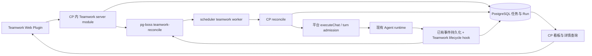

# QAP Teamwork Plugin 技术方案：任务驱动协作与 Kanban

状态：设计建议，未实施。初稿：2026-09-08；Plugin 可行性复核与修订：2026-09-10。

代码基线：QAP `bb2ef47`；本地 Symphony `8001b52`。以下“当前”指此次本地代码检查，“建议”指待建设能力。适用于通用 Agent 协作，以 QA 回归任务举例。本次只产出方案，不启动服务、不运行 Agent、不启用 sandbox、不请求 Windows 管理员提权。

## 1. 核心决策

将现有 Teamwork 领域整理为 QAP 的第一方功能插件：**一个主任务、一名协调员、一组成员、若干可追踪子任务、多次执行记录**。插件拥有持久任务状态、协作规则与 Kanban；平台继续提供 Workspace、Session、可靠执行与文件能力。发布形态明确为“独立 Web bundle + 随 CP 部署的 server module + 协作模板”，当前并非任意后端代码可动态安装的插件系统。

复核结论：方向成立，但实施前必须补上 fleet 级插件入口、通用 SessionView、服务端生命周期、协议版本检查。不能直接把现有 TeamworkSection 打成 JS bundle 后宣称具备完整后台插件能力。详见第 3.1 节。

借鉴 Symphony 的任务驱动、状态对账、受控续跑和工作记录；沿用 QAP 的 TypeScript control-plane、PostgreSQL、pg-boss、Agent 适配层和 React UI。不引入 Elixir 服务，不增加第二套 Agent runtime，不要求接入 Linear，也不将 sandbox-service 作为 Teamwork 的依赖。

三个边界必须明确：

- **Task / Work item 是要交付的工作**，可以跨多次会话和重试。
- **Run 是一次受平台管理的 Agent turn 执行尝试**，结束只说明这一轮停止。
- **Session 是上下文容器**，用于延续对话；`chat_status` 不作为任务业务状态。

任务完成以结构化交付与验收为准，不能靠“最后一条消息说完成了”、工具调用结束或连接断开判断。

## 2. 当前代码已经具备什么

| 当前能力 / 限制 | 代码证据 | 对方案的影响 |
| --- | --- | --- |
| Task 已有 owner、name、brief、coordinator、AFS share，没有业务 status | `control-plane/src/services/db/teamwork.ts`：`TeamworkTask` | 扩展主任务领域，不重建另一套 task 系统 |
| 已有创建、成员、会话、chat API | `control-plane/src/routes/teamwork.ts` | 保留 API 组织方式，状态修改集中到 command service |
| 已有 roster 和 task-session 关系 | 同上及 DB 模块 | 复用并强化约束；不从消息反推持久关系 |
| 已有列表、详情、聊天、文件与协作时间线 | `web/src/components/teamwork/TeamworkSection.tsx`、`TeamworkTimeline.tsx` | 重组 UI，保留已有可复用组件 |
| 当前成员聊天页签由 `deriveMemberSessions()` 解析协调员 tool result 得到 | `TeamworkSection.tsx`：`TaskDetailView` | 页面可能受当前会话和消息加载范围影响；改为后端关系查询 |
| Task context 在前端 `buildTeamworkContext()` 拼接 | 同一文件 | 移到服务端，让 Web / API / scheduler 得到同样的任务上下文 |
| 协调员 chat 走 `dispatchChatTurn → executeChat`，支持 async，连接断开后仍持久化 | `services/chat/dispatchChatTurn.ts`、`executeChat.ts` | 复用会话执行和 SSE，不另建长连接执行器 |
| `call_agent` 直接 fetch Agent `/chat` 并走 `runSubAgentTurn` | `control-plane/src/mcp/tools/agent.ts` | 不能假定成员调用已受 `executeChat` 的 turn-gate 约束，需要统一执行入口 |
| 成员会话注册的 `parent_session_id` 当前写 null | 同上 | 新增显式 run / parent run 关系，恢复真实调用链 |
| MCP 从 session token 查 task，但只为协调员保留 task 上下文 | `control-plane/src/mcp/server.ts` | 成员结果工具需要独立、收窄的 work-item/run 授权上下文 |
| 已有 pg-boss 调度与 worker 心跳、死信处理 | `scheduler/src/index.ts`，CP / scheduler 的 `package.json` | 复用队列基础设施，新增独立 teamwork worker |
| 已有 session reconnect 和 orphan recovery | `control-plane/src/lib/session-recovery.ts` | 先恢复/确认执行，再考虑重试，不能把 idle 当成功 |
| 当前共享目录在创建时分配，删除 task 时销毁 | `routes/teamwork.ts`、`services/teamwork.ts` | 将创建草稿与运行环境准备分离，完成任务时保留交付物 |

当前文档有两处不宜直接当实现事实：`concepts/teamwork.md` 写了“任务结束回收”，但当前代码没有完成状态；同一 Workspace 的协调员自调用也被 `call_agent` 明确拒绝。方案不依赖这两项已完成。

本地 AFS 服务代码与 Teamwork 注释表明共享与环境相关，但当前添加成员路由未见同环境检查。新流程应显式验证共享可达性，不能仅判断 `status=running`。

## 3. Symphony 借鉴范围

本地 Symphony README 的演示说明是 **Linear board + Symphony 执行**。其 Phoenix 页面是运行监控页：Running sessions、Blocked sessions、Retry queue、用量；路由提供 `/api/v1/state` 与单 issue 的 JSON 详情，并没有本地可编辑 Kanban 组件可直接移植。本地版本已有 Linear、GitHub、GitLab、Jira、Asana 等 tracker adapter，不能把它概括为只支持 Linear。

| Symphony 模式 | QAP 的对应设计 |
| --- | --- |
| Tracker 保存工作项与业务状态 | PostgreSQL 中的 teamwork_tasks / work_items 为唯一业务事实来源 |
| Orchestrator 是调度状态唯一写入者 | CP 的 Teamwork command / reconcile service 是唯一状态写入入口 |
| 每次 tick 先 reconcile 再 dispatch | 每次唤醒先核对 run、停止意图、依赖、权限和额度，再派发 |
| Worker 成功退出不等于 issue 完成 | Run succeeded 不等于 Task done；协调员提交结果，人验收 |
| 有界连续 turn、失败退避 | 持久化续跑次数、重试时间和原因，明确区分正常续跑与失败重试 |
| WORKFLOW.md 的流程约定与工作记录 | 服务端 task context + 结构化 workpad + 已有 Workspace prompts / skills |
| 运行快照与具体 issue 详情 | Kanban 显示任务摘要，详情显示 Run / Session / Activity / 交付证据 |
| 每 issue 独立仓库目录 | QAP 每工作项独立输出目录；代码写入另用该 Workspace 内 worktree |

不照搬：Symphony 的内存调度事实来源、Codex app-server 直连、宿主机进程管理、自动合并 PR、任意 shell hooks、WORKFLOW.md 热加载和外部 tracker 同步。QAP 已有持久化控制面与多 runtime，适配层和权限边界应继续有效。

主要参考：本地 `SPEC.md` 第 7、8、10、13、14 节；`elixir/lib/symphony_elixir/orchestrator.ex`；`agent_runner.ex`；`elixir/WORKFLOW.md`；`elixir/lib/symphony_elixir_web/{presenter.ex,live/dashboard_live.ex}`。


### 3.1 Plugin 可行性复核（2026-09-10）

**结论：可以采用 QAP Plugin 产品形态；现有插件系统足以作为前端分发基础，但还不具备后台任务编排和全局应用扩展的完整契约。** 本方案选择“独立前端 bundle + 随 CP 部署的第一方 Teamwork 模块 + 协作模板”。这是明确的部署边界：UI 可以独立发布；更改服务端编排实现需要更新 CP，不能把它描述为上传一个 JS bundle 就安装完整后台能力。

本次直接读取本地工作区文件，没有启动 Shell、sandbox 或管理员提权。下表是实现事实，不是待实现能力：

| 检查点 | 当前证据 | 必须调整的设计 |
| --- | --- | --- |
| 前端插件分发 | `control-plane/src/routes/plugins.ts` 接收 id/version/bundle/metadata；DB 保存 bundle | 复用上传和加载机制；不把 manifest 当服务端代码安装器 |
| 插件可注册内容 | `web/src/plugins/types.ts` 只有 toolResultHandlers、panels | 新增 fleet 级 app 贡献；不伪造 Workspace 来承载首页看板 |
| Workspace 面板发现 | `useWsApps.ts` 检查 enabled MCP 的 `ui_panel`；`PluginPanelProps` 要求 workspaceId | Teamwork 首页入口不依赖某一 Workspace 的 MCP 是否开启 |
| 当前 Teamwork 首页入口 | `useFleetApps.ts` 硬编码 TeamworkApp；`wsApps.tsx` 直接加载 TeamworkSection | 用插件 app 注册替代这两个内置入口，不留下两个 Teamwork |
| 前端 host | `web/src/lib/host.ts` 导出 `window.tos`，共享 React/ReactDOM、注册面板、会话 hooks 和 UI helpers | 复用 host；当前没有全局 app 注册与完整嵌入聊天组件，按需要补两个扩展点 |
| 工具结果监听 | `web/src/plugins/registry.ts` 在懒加载首次匹配时明确允许丢弃当前事件 | 只用于 UI 缓存刷新；任务状态由服务端持久事件和 reconcile 推进 |
| 当前停用 | `setPluginEnabled` 只改 DB 布尔字段；loader 的 loaded/pendingLoads 在浏览器内缓存 | 当前 disabled 不能保证停止执行或卸载已加载 JS；必须新增服务端生命周期判定 |
| 当前版本分发 | bundle URL 带 v，但 `getPluginBundle(id)` 只查询当前 bundle；metadata 仅 JSON.parse | 首版升级前 drain，bundle URL 版本必须匹配实际内容；不能假定能取回旧版本或并行运行多版本 |
| 已有后端注册 | CP index 直接挂载 `/api/teamwork` 和 `/api/plugins` | 前者转由第一方扩展入口挂载；后者继续作为 bundle 分发接口 |

#### 3.1.1 一个产品，三个组成部分

| 组成 | 拥有的内容 | 部署 / 发布 |
| --- | --- | --- |
| Teamwork Web plugin | 七列 Kanban、任务详情、成员、结果卡片、API client | 现有 IIFE bundle 上传与分发；React 取自 host |
| Teamwork server module | task/work-item/run 投影、业务状态机、领域 API/MCP、reconcile、资源组织与模板快照 | 受信任的一方源码模块，CP 启动时静态注册；scheduler 加载同一功能的薄 worker |
| Workflow templates | 协调员任务说明、成员职责建议、输入输出和验收要求 | 首版随插件提供一个默认模板；任务开始时保存实际内容快照 |

平台继续拥有认证、Workspace/Session、实际 Agent 执行、admission、原生审批/问题、interrupt/reconnect、队列引擎和 AFS 基础操作。任务优先级、依赖是否满足、成员结果是否通过、进入待验收等规则全部属于 Teamwork server module。

`teamwork_runs` 仍是该插件的调度/结果记录，并引用平台执行身份；平台负责提供可确认的执行事实。不能把 Teamwork 的业务表读写重新散落到通用 executor、runtime adapter 或前端 host。通用执行层通过持久化事件和有界生命周期回调提供事实；Teamwork 模块更新自己的投影。外部 runtime 仍使用现有适配器，不另建执行服务。

#### 3.1.2 最小宿主扩展

1. **Fleet app contribution。** 在 WorkspacePlugin 增加 apps 贡献，并在 manifest owns 增加对应 app 描述（id、label、scope=fleet）。registerPlugin 继续是唯一注册入口；新增可订阅的 app registry，useFleetApps 合并已启用插件的 app。lazy loader 可从 app 占位入口触发加载。appId 采用插件命名空间 `teamwork.board`，防止覆盖宿主内置 app。
2. **会话视图。** 给 host 增加通用 SessionView（workspaceId、sessionId、只读/可交互模式），内部复用现有会话 Provider、ChatPanel 和原生问题处理；插件只选择目标，不复制聊天 store，不直接 import 宿主私有源码。host 当前导出的会话 hooks 依赖正确的 Provider，不能在 fleet 根组件裸用。
3. **明确的协议检查。** Teamwork UI 声明所需 host API 与 Teamwork API 协议版本，服务端提供 capabilities 查询；进入界面及发写命令前验证。不匹配时阻止写操作并要求更新，不走旧接口回退。共享最小契约类型，不把 Teamwork client 方法挂进全局 window.tos。
4. **服务端静态扩展入口。** 新增一个 Teamwork register 入口组装路由、MCP、持久化生命周期处理和队列；CP 与 scheduler 显式调用。只提供本插件需要的依赖，不做任意 npm 包安装、动态模块 loader 或通用插件市场。
5. **生命周期协调。** 插件管理中的 Teamwork 操作必须经过 server module。现有通用 enabled/delete/upload 接口对 Teamwork 也要检查 drain 和版本规则，不能留下绕过入口。

这些是“为了这一个已确定插件新增的边界”，不是已有 host API。面板、工具 renderer、React 共享等现有能力继续复用。前端插件拥有自己的领域 client 和查询状态；使用 React Query 时明确提供对应 QueryClientProvider，不假设宿主已导出共享查询上下文。

#### 3.1.3 安装、停用、升级

首版管理员启用范围为整个平台，task 的数据权限仍按 owner。插件前端作为受信任的同源 JS 执行，拥有当前用户可用的浏览器上下文；manifest 能力声明不会自动产生安全隔离，授权仍在服务端。

- **安装/启用：** CP/scheduler 部署中必须已有匹配的 Teamwork 模块及 schema；上传前端 bundle，验证协议与 worker 可用后启用。只有 UI bundle 时显示“缺少 Teamwork 后端能力”，不接受开始任务。
- **active：** 允许新任务与已有任务正常推进。
- **draining：** 拒绝新建、新任务 start；在进入 draining 前已被授权开始的任务允许成员派发、续跑、回复、返工和验收，直至 done/cancelled。不能只等当前一轮 Run 结束就停掉插件。仍保留看板与处理入口。需要立即停用时，管理员明确取消这些任务，等待真实停止确认。
- **disabled：** 已无需要推进的任务与未知执行；所有后台派发拒绝。只读历史 API 和数据保留，bundle 保留时 UI 可只读浏览。重新启用后可开始尚未启动的草稿。
- **卸载 UI bundle：** 只允许 disabled；历史数据库、Session 与文件不删除。移除入口后，通过授权 API或重新安装同版本查看历史；不承诺被卸载的 UI 仍然存在。
- **升级：** 首版先 draining，确认没有在途执行、未解决 unknown、需要续跑或等待验收的旧任务，再更新 server module 与 bundle，检查协议后启用。缺失或不匹配当前 Teamwork API 协议版本的写请求被拒绝；协议匹配的页面仍按 lifecycle 判定，不依据页面打开时间拒绝。不同时维护两套后端实现，不给旧 preview 做状态推导或迁移。

新增单行持久配置 `teamwork_plugin_settings(lifecycle, version, updated_at)`，生命周期是 server module 的唯一执行开关；现有 `plugins.enabled` 仅决定 bundle 分发，不决定后台是否可执行。start 和进入 draining 对该行加锁并与 task 授权写入同事务，避免新任务漏入 drain 边界。`task.started_at` 定义为首次 start 命令被接受的时间；实际执行起点使用 run.started_at。disabled 检查所有已授权且非 done/cancelled 的任务、非终态 Run 和未完成资源操作；blocked/unknown/in_review 都需要先处理。浏览器本地卸载不作为该检查的依据。

队列消息在执行前重新读取 lifecycle；draining 只处理已授权任务，disabled 只允许历史读取和必要的幂等资源清理，不得恢复模型执行。即使有人保留旧 bundle 或直接调用 API，服务端判定仍生效。

#### 3.1.4 模板灵活性与首版边界

首版模板包含 id/revision、协调员指令、成员职责建议和验收/产物要求，采用固定 Zod schema。任务开始保存 `workflow_snapshot`（版本及实际模板内容）；后续续跑/返工使用该快照。修改模板影响尚未开始的新任务，不中途改变已启动任务的协作协议。成员仍绑定用户选择的真实 Workspace；不靠模板自动创建 Agent 或改全局配置。

模板只能提供领域内容，不定义任意状态、脚本 hooks、任意递归图，也不能覆盖 owner、并发上限、停止与审批规则。冻结的是协作模板，不代表底层模型、第三方工具或 Workspace 配置被完整锁定；本方案不承诺完全可复现执行。

QA 回归、调研和代码交付可以以后作为模板扩展。Kanban 首版始终使用第 4 节的七个业务状态，每个状态单独一列。只需一个协调员的任务同样可完成，不强制成员数量。

如果要求“任意服务端编排代码也能像前端 JS 一样上传安装、无需更新 CP”，当前方案不提供此能力；那需要另行设计独立后端服务及其认证、事件投递、执行协议和发布生命周期。此次按现有 QAP 架构选择受信任的第一方模块，作为明确的长期部署方式，而非临时过渡。

## 4. 用户交互

### 4.1 全局看板：一张卡代表一个主任务

通过插件贡献注册首页 Teamwork app，复用现有应用窗口体系，默认展示 Kanban；移除旧内置入口。第一版不引入 Project / Board / Sprint 新实体。

每个业务状态单独一列，固定七列依次为：**待规划、待执行、进行中、阻塞、待验收、已完成、已取消**。所有列在同一横排，任务卡片在所属状态列内纵向排列；列顺序表达展示顺序，不表示任务必须依次经过阻塞或已取消。列宽建议 240–280px，窗口不足时仅看板区域横向滚动，不换行、不把多个状态合并成一列；窄屏同样保留状态列并允许左右滑动。空列保留标题和计数 0。默认仅展示最近的已完成/已取消任务，支持继续加载；列计数是筛选后的服务端总数，不是当前已加载卡片数。

卡片字段：短编号、标题、优先级、协调员、已完成子任务数 / 总数、最近进展、最后活动时间。有异常时显示明确标记，例如“等待输入”“20 秒后重试”“取消中”。不显示模型猜测的百分比。

示例：

```text
进行中 · 3
┌───────────────────────────────┐
│ TW-128                  高优先级 │
│ 优惠券 V2 回归验收               │
│ QA Lead · 子任务 2 / 4          │
│ API 回归完成，UI 回归执行中       │
│ 等待输入 1             30 秒前   │
└───────────────────────────────┘
```

操作约定：

- 点击卡片打开右侧详情，保留看板筛选与滚动位置；“展开”进入应用内完整详情视图。
- 详情深链接由现有 app 导航参数承载 `taskId` / `workItemId` / `runId`，不能只放在 localStorage；刷新、复制链接可恢复。
- 新建只需要标题、目标/验收标准、协调员；成员可后补。默认存为待规划；“创建并开始”是显式的执行授权。
- 拖动表达业务命令，绝不允许直接写 `status`。例如“待规划→待执行”是开始；“待验收→已完成”是验收通过。
- 不允许把运行卡片直接拖入已完成。正在运行的任务暂停/取消需走停止流程，并先显示“暂停中/取消中”。
- 第一版列内按优先级、创建时间、ID 排序，不做手动排序持久化。拖拽只跨合法状态列，提供同等能力的菜单与键盘操作。
- 并发修改使用 `version`；冲突后撤销乐观变化，拉取新状态并解释原因。
- 列为空显示清晰空态；加载失败可重试；实时连接断开显示“状态更新已断开”和最后成功同步时间。

### 4.2 详情：先看工作，再下钻对话

桌面详情侧栏建议宽度 560–680px；完整详情采用“内容主体 + 约 280px 属性栏”。窄窗口改为全宽详情，避免沿用当前固定 360px 左栏挤压聊天。

```text
TW-128  优惠券 V2 回归验收        进行中       [暂停] [更多]
概览 | 子任务 | 执行记录 | 会话 | 交付物

目标与验收标准                   协调员：QA Lead
覆盖核心券型；失败项有证据        成员：API / UI / 分析
                               优先级：高
最新工作记录                    创建人、时间、最近活动
API 已通过，UI 正在验证叠加规则

子任务 2 / 4
✓ 分析需求     ✓ API 回归
● UI 回归      ○ 汇总报告（依赖 UI 回归）

活动
14:21 UI Agent 开始执行 · Run #3
14:20 API 回归提交证据 · report.json
```

| 页签 | 展示内容 | 关键操作 |
| --- | --- | --- |
| 概览 | 目标、可勾选验收项、当前进展、阻塞原因、最新活动 | 编辑未开始的目标；待验收时通过或退回 |
| 子任务 | 标题、执行成员、状态、依赖、结果摘要 | 点开子任务；失败重试；调整未执行任务 |
| 执行记录 | 每次 Run 的类型、时长、状态、错误、重试时间、输入输出用量 | 切换历史 attempt；打开对应 Session |
| 会话 | 协调员与成员会话树、已有聊天面板和协作时间线 | 向协调员补充信息；回答定位到具体 session 的问题 |
| 交付物 | 输出文件、报告、链接、验收证据及所属 Run | 预览、下载、查看来源 |

侧栏先渲染概览，仅展开会话页签才订阅 token 流。用量来自现有 usage 账本，按 run/session 去重；不同 runtime 未提供的指标显示“未提供”，不显示 0 或估算费用。

等待输入展示具体问题和提问 Agent，回答必须路由到原 session。人工中途补充说明属于用户命令，可排队到协调员下一轮；不能让 UI 直接并发启动第二轮协调员。普通评论只记录活动，不默认唤醒 Agent。

## 5. 状态模型与转换权限

### 5.1 主任务业务状态

| 状态 | 含义 | 进入条件 / 离开方式 |
| --- | --- | --- |
| `backlog` 待规划 | 草稿，不消耗运行资源 | owner 开始后进入 ready；可取消 |
| `ready` 待执行 | 已授权，等待首次执行 | admission 后进入 in_progress；准备失败进入 blocked |
| `in_progress` 进行中 | 已开始且仍在推进，包括短暂排队或自动重试等待 | 无可推进工作时 blocked；交付验证后 in_review |
| `blocked` 阻塞 | 没有可推进工作，需要输入、修配置或人工恢复 | 解除原因后回 ready（从未启动）或 in_progress（已启动） |
| `in_review` 待验收 | 协调员已提交最终交付；所有执行已停止 | owner accept → done；rework → in_progress |
| `done` 已完成 | owner 已验收当前结果版本 | 可归档；首版不重新打开，后续工作新建任务并关联来源 |
| `cancelled` 已取消 | 已停止所有该任务的执行 | 可归档；首版不自动恢复 |

`blocked_reason` 采用固定类别：`awaiting_input / paused / dependency / execution_failed / workspace_unavailable / permission_changed / budget_exhausted / execution_unknown`，另有可读说明与关联 work_item/run。

只有成员之一等待输入、其他子任务还在运行时，主任务保持 in_progress 并显示 attention 标记；当整项工作都无法推进时才进入 blocked。依赖等待中的子任务不应把仍在推进的主任务整体标成阻塞。

暂停不是立即修改业务状态。先持久化 `control_intent=pause`，阻止新 dispatch，向该任务的活动 sessions 发 interrupt；收到终止证据后进入 blocked/paused。取消同理，终止确认后才进入 cancelled。HTTP 200 或请求已送达不等于已中止；当前 `interruptAgentSession` 已区分 delivered 与 interrupted。

### 5.2 子任务与 Run

子任务固定状态为 `ready / running / blocked / done / cancelled`。是否依赖未满足由显式依赖关系计算。子任务结果先由执行 Agent 提交，协调员接受后才成为 done；接受前显示 running + “待协调员确认”。

Run 状态为 `queued / starting / running / waiting_input / succeeded / failed / interrupted / unknown`。`succeeded` 代表本轮正常结束，不意味着子任务被接受或主任务通过验收。暂停和错误是不同终止原因。

结构化工具提交的结果先绑定当前 run；只有本轮成功结束后才成为可接受的结果。迟到结果、取消后的结果、旧 run 的结果保留到历史，但不能覆盖当前工作状态。

### 5.3 自动推进的确定性

- 协调员负责拆分、指定成员、接受子任务结果、汇总交付；scheduler 按批准的 work items 派发，成员不自行无限递归委派。
- 第一版允许协调员直接提交结果，不要求为了多 Agent 形式而强制创建子任务。
- 第一版不增加“计划确认”强制关卡；用户开始即授权在目标和 roster 内工作，最终验收仍由用户完成。
- 最终提交必须包含摘要、逐项验收证据、产物引用，且所有必需子任务已 done、没有活动 Run、没有未决输入。
- 协调员提交最终结果的那一轮仍为活动 Run，因此先记录提交意图，在该轮成功终止后检查条件并转 in_review。
- owner 的验收请求必须携带 `result_run_id` 与 `version`，防止接受已被替换的交付物。
- rework 保留历史结果，清除“当前待验收版本”，加入修改说明并创建协调员续跑；不重跑已完成子任务，除非明确重新打开对应项。

## 6. 数据模型

当前三张 Teamwork 表的领域归属移入插件，新增三个核心业务表；依赖关系在第二个交付阶段加一张关系表。另新增第 3.1 节的单行 teamwork_plugin_settings 管理插件生命周期，task 增加 workflow_snapshot 保存已采用的协作模板。表名和字段是建议契约，不是已实现 schema。

| 表 | 主要字段 / 变化 |
| --- | --- |
| `teamwork_tasks` | 保留当前字段；新增 `status`、`priority`、`acceptance_criteria`、`version`、`control_intent`、`blocked_reason/detail`、`workpad`、`result_run_id`、`next_run_at`、`retry_count`、`coordinator_turn_count`、`started_at`、`completed_at`、`archived_at` |
| `teamwork_participants` | 继续引用 workspace；新增职责 `role_description`。协调员仍在 task 上，不重复成为 participant |
| `teamwork_sessions` | 保留 task/session/role/parent_session_id；增加 `work_item_id`（协调员为空）；session 必须唯一属于一个 teamwork task / work item |
| `teamwork_work_items` | `id/task_id/title/description/acceptance_criteria/assignee_workspace_id/status/required/result_run_id/next_run_at/retry_count/version` 及时间戳。所有 work items 只有一层，继承主任务 owner、roster、共享目录 |
| `teamwork_runs` | `id/task_id/work_item_id/session_id/parent_run_id/attempt/kind/status/dispatch_key/runtime_instance_id/request_version/started_at/ended_at/last_event_at/error_code/error_detail/result_json`；kind 区分 initial、continue、retry、rework |
| `teamwork_events` | `id/task_id/work_item_id/run_id/type/actor_type/actor_id/payload/dedupe_key/created_at`；低频业务活动与审计，不保存每个 token |
| `teamwork_work_item_dependencies`（第二阶段） | `(work_item_id, depends_on_work_item_id)`，两端 FK、联合唯一、同 task 检查；添加依赖时验证无环 |

结果 JSON 使用共享 Zod schema：`summary`、`acceptance_checks[{criterion_id, outcome, evidence}]`、`artifacts[{name, kind, relative_path_or_url}]`。输出状态限制为 passed / failed / not_run，不允许“未知”自动当通过。产物先绑定 Run，不另造文件存储服务。

恢复所需的附加字段也必须进入首版 schema：task 保存 `resource_state/resource_error`（unprepared/preparing/ready/releasing/released/failed）及已成功创建的 share/mount 记录；Run 保存 `pending_requests`（原生 request id、种类、所属 Session、状态）、`input_event_ids`、`pending_decision`。协调员 Run 在创建事务内预留本轮输入事件，预留不等于已处理；接受/返工决定和用户输入确认写对应的消费事件，事件 payload 引用被消费的 event id 并以 dedupe_key 去重。重试保留同一输入集合中的未完成部分；成员结果只在被接受/返工后标记已处理。去重依赖这些持久事实，不依赖内存游标。

文件产物 schema 增加 `sha256/size_bytes`，平台在提交时通过已有文件访问路径计算，写入 Run result；验收前重新核对。外部链接只记录 URL 和提交时的说明，不宣称其内容不可变，不能单独充当需要固定内容的验收证据。资源分配每成功一步立即记录可恢复身份，失败保留阶段与错误；pending request 在原生事件持久化时写入，回答/终止后收敛。

关键约束：

1. 每个 work item 最多一个非终止 Run；每个主任务最多一个非终止协调员 Run。PostgreSQL partial unique index 分别覆盖 `work_item_id IS NULL` 和非空路径，不能用 nullable 联合唯一索引误以为约束了协调员。
2. 所有关系写入验证 task 一致；Session 不得跨任务或跨 work item 复用。需要不同成员工作的同一 Workspace 使用不同 Session。
3. task/work-item `version` 乐观锁，关键调度时 `SELECT … FOR UPDATE`；不持有事务等待模型输出。
4. `dispatch_key` 唯一；Run result 只能由该 run 的绑定身份写入。`dedupe_key` 约束重复事件。
5. 依赖双方属于同一 task；依赖取消不自动等于满足。协调员需显式修改依赖或取消受影响项，并记录理由。
6. 活动索引 `(task_id,id)`；看板索引 `(owner_user_id,status,priority,created_at,id)`，归档单独过滤。

不为旧 preview 数据编写兼容层、旧状态推导或数据迁移脚本。开发按仓库现有 schema 管理方式更新规范定义和 fixtures；已有环境的数据处置是部署前单独决策，本次不删除数据，也不假设可直接清空生产库。

## 7. 服务职责与执行流程



**部署在 CP 内的 Teamwork server module** 负责任务授权、状态机、规划与交付工具、Run claim、结果确认与快照查询；CP 平台层负责实际执行与通用身份校验。**部署在 scheduler 内的 Teamwork worker** 只消费短时 reconcile 工作、调用 CP 内部授权端点，并定期请求补扫。它不另写 task 状态，不复用假装是 schedule 的记录，不持有一个贯穿整个项目的长任务。全文后续“CP 更新任务/对账”均指该模块执行业务逻辑。

用 `teamwork-reconcile` 队列传递 `{task_id}`，不是把原始 prompt 当作可无限重放的 job。事件触发及时唤醒；每分钟补扫 ready、到期重试、停止中、未知和长期无事件任务。每次处理先 reconcile 再 dispatch；扫描间隔与立即唤醒分别承担漏通知恢复与交互响应。

执行步骤：

1. 用户开始：事务校验 owner、目标与 coordinator，更新 ready，写 task.started 活动并入队，提交后返回。
2. Worker 请求 CP reconcile；CP 锁住任务，先处理已有 Run、control intent 与未决结果，不满足推进条件则返回。
3. 首次运行时准备 AFS 与必要挂载；验证 roster、同环境、Workspace 可运行。准备失败进入 blocked 并显示具体资源问题。
4. 短事务创建 queued Run 并占用唯一约束，提交后调用统一执行入口。拿到 admission 才进入 starting/running，避免 UI 把容量排队显示成运行。
5. 执行入口从 DB 生成 context，关联 run、session token 与实际 Session。任务上下文不接受浏览器伪造的成员名单。
6. 已有持久化链写消息；Teamwork hook 在对应事件提交后写 Run 生命周期和业务事件，再触发 reconcile。
7. 协调员提交 work items 后，当前协调员 turn 结束，scheduler 才派发独立成员工作；依赖未满足的不派发。
8. 成员结果使协调员的待处理工作可用：没有活动协调员 Run 才唤醒一次；同一期间多个成员结果合并进入下一轮，不每条结果启动一个 coordinator。
9. 协调员接受结果、继续拆分或提交最终交付；最终进入 in_review 后停止自动执行，等待 owner 验收。

成员工作项只有在 `status=ready`、依赖全满足、没有未确认结果、没有任何非终止 Run、无停止意图、权限及预算通过时可 claim。结果待协调员确认期间不可重派。需要追加执行必须由协调员明确接受返工/续跑决策，清除当前待接受结果引用并把该项变为 ready，旧结果保留在历史。

协调员只在首次启动、存在未处理的成员结果/用户输入、或上一轮明确提交 continuation 决策时可派发。上述输入在 claim 事务内绑定 Run；重复 reconcile 不得重复消费。没有结果也没有下一步决策的正常结束进入 blocked/execution_failed（说明为“未提交执行决策”），不凭空自动续聊。失败重试仍处理原输入集合，成功消费不能因新通知再次执行。

`pending_decision` 是有限枚举 `continue / wait_for_items / submit_review / blocked`。`teamwork_plan_items` 同时记录 wait_for_items；`teamwork_report` 可提交 continue/wait_for_items/blocked，并指定本轮已处理的用户输入 event IDs；`teamwork_submit_review` 记录 submit_review。wait_for_items 允许协调员正常结束并等待相关成员结果，不判协议失败；若尚有未处理输入，必须明确 continue 或 blocked，不能仅凭 Run succeeded 一次性消费整个集合，也不能无决策反复唤醒。owner rework 的修改说明写入新的用户输入事件并入队，确保下一轮可被确定性触发。

Run 从 queued 进入 admission 时必须重读 control_intent 和 request_version，失效请求不再发送。若请求已在途，Run 仍属于活动约束，暂停/取消必须按 dispatch identity 查询/停止，即使尚无 Session ID；只有确认未被接受或原执行已终止，才能释放约束并完成取消。unknown 同样占用约束；发送前检查不是跨网络原子保证，停止流程必须覆盖这个窗口。

**数据库提交与入队应同事务。** 已核对项目声明的 pg-boss 12.14.0 API：`SendOptions` 包含 `ConnectionOptions.db`，可以通过当前事务 client 的 `executeSql` 实现事务内 send；不需要先新增 outbox 框架。[12.14.0 类型定义](https://raw.githubusercontent.com/timgit/pg-boss/12.14.0/src/types.ts)、[官方事务文档](https://pgboss.io/api/adapters)。

Queue job 成功只表示完成一次 reconcile。允许重复 reconcile 消息，由业务锁和 Run 唯一约束去重；不把队列的投递保证当作模型与外部副作用的 exactly-once 保证。低频补扫恢复漏发或 worker 崩溃导致的漏推进。

## 8. 恢复、并发与运行预算

### 8.1 区分三种重试

| 场景 | 行为 |
| --- | --- |
| reconcile HTTP 暂时失败 | pg-boss 可重试短时对账；只查询/收敛已有 Run，不盲发同一 prompt |
| Run 明确失败且原因可重试 | CP 记录 `next_run_at` 与 retry_count，使用同一 work item 新建 attempt；默认最多 3 次，10s/20s/40s，可尊重提供方 Retry-After |
| 正常结束但工作未完 | 正常 continuation，新 Run 复用该工作项 Session，不计入失败重试；协调员自动 turn 默认总计最多 20 次，超限 blocked/budget_exhausted |

以上数值是首版建议常量，需实际验证后调整，不提供大而全的用户配置界面。默认 Task 内最多 3 个成员 Run 同时执行；Workspace 实际容量继续由 turn-gate 控制，不能将它与 pg-boss worker 数量混为一谈。等待成员时不运行协调员轮询 turn，因此不会由持槽同步等待制造同 Workspace 死锁。

### 8.2 不确定执行不能直接重试

必须覆盖“请求已被 Agent 接收，但 CP 没拿到 session_id 就崩溃”的窗口。平台侧的数据库唯一键只能防重复 claim，不能证明 Agent 没执行。

在统一内部运行协议中携带稳定 `run_id/dispatch_key`，由现有三个 runtime adapter 记录并支持查询该次执行；重复 dispatch 在同一 runtime 实例中返回原执行身份。CP 在发请求前保存身份，Session 创建后绑定到该 Run。适配器进程重启应暴露不同的 runtime instance 标识，不能把内存去重描述为跨重启持久保证。

- Session 已知：复用现有 reconnect，先恢复已发生的事件，再确认终态。
- Session 未知：按 dispatch key 查询该 runtime；确认仍运行就绑定/追踪，不再启动第二份。
- 已成功完成但漏记：补写结果与事件，不重发 prompt。
- 网络不通、实例已更换且无法证明旧执行终止、外部副作用不确定：Run 进入 unknown，任务 blocked/execution_unknown，人工核查后才决定继续。
- 只有“确认未接受请求”或“旧执行已终止且操作可重试”才允许自动重试。SDK/外部系统副作用仍需业务幂等键和结果核查，平台不承诺 exactly-once。

unknown 只能由 owner 使用 `resolve_execution` 命令处理，普通 retry/resume 一律拒绝绕过。命令必须指定 run_id、expected_version、证据说明和结论：`bind_existing`（由 CP 验证原执行身份后绑定）、`confirmed_not_accepted`、`confirmed_terminated`（同时明确副作用已核查、是否可重试）。最后两项把旧 Run 收敛为相应终态；仍有停止意图时只完成停止，不派发；否则才允许显式 retry。证据不足保持 unknown。结论、操作者和时间进入 events，不用删除原 Run 解锁。

这属于实现首个自动执行闭环的前置条件，不能等自动重试上线后再补。第一阶段只需把未知情况准确呈现并阻止重复运行；不要求自动解决所有异常。

### 8.3 生命周期细节

- 浏览器关闭：只断 UI 订阅，Run 继续。
- CP 重启：恢复 Session 与 Run 绑定后再开放新 dispatch；不得因 `chat_status=idle` 自动标 done。
- scheduler 重启：队列与 DB task 状态恢复；重放 reconcile 不新建重复 Run。
- 运行无事件：以模型/工具进展时间检测，不把 SSE heartbeat 算进展；长工具执行应结合 runtime 状态，先查询再中断，停止未确认不重试。
- 等待问题/审批：记录 waiting_input 与具体 request id；回复走原生 question/permission 协议，不用普通聊天消息替代工具审批。
- 暂停/取消：先持久化意图，再中断该 task 的 sessions；不得停止整个共享 Workspace，防止影响其他任务。
- 移除成员、修改执行成员、变更验收目标：有活动相关 Run 时拒绝变更，需先停止；未开始的任务可以编辑。工作记录和非执行性评论不受此限制。
- AFS 分配、挂载、回收不是 DB 事务：持久化准备阶段，按 task/share 标识幂等核查；部分失败可重试和补偿。不能“吞掉 revoke 错误再删 DB 记录”，否则失去清理依据。

目前 CP turn-gate 明确按单进程设计。本方案按此部署拓扑成立；多个 scheduler 实例可以投递对账。若要多 CP 活跃副本，必须先建设跨副本 turn admission 和流路由，不能仅凭新 Run 表宣称整个平台已支持多 CP 并发安全。

## 9. 工具与 API 契约

### 9.1 Agent 工具

Teamwork 的调度不能继续依赖协调员自由 `call_agent` 后再解析消息。新增少量领域工具：

| 工具 | 允许调用者 | 行为 |
| --- | --- | --- |
| `teamwork_get_context` | 绑定的协调员 / 成员 Run | 返回本任务或本人工作项、相关依赖结果、可用产物、剩余预算 |
| `teamwork_plan_items` | 协调员 | 持久化工作项及后续阶段的依赖；返回 work_item IDs；执行由 scheduler 决定 |
| `teamwork_report` | 协调员 / 成员 | progress / blocked / result；提交当前 Run 的结构化结果或工作记录。协调员还可提交有限 next_decision 和已处理用户输入 IDs；成员无编排决策权限 |
| `teamwork_accept_item` | 协调员 | 接受指定 result_run_id，或者提交返工说明使工作项可再次执行 |
| `teamwork_submit_review` | 协调员 | 提交主任务交付与验收证据，平台在该轮结束后检查并转待验收 |

Task / work-item / Run 身份来自 session token 的服务端绑定，不由工具参数任意指定。协调员权限限于该 Task 的 roster 和 work items，成员只能提交自己当前工作项。首版成员不再委派下一级，避免递归树和额外权限模型。

普通 Workspace 继续拥有 `call_agent`；受管 Teamwork sessions 的跨 Agent 执行统一走 work-item 工具，移除该场景下原有自由派发路径。二者是不同使用场景，不是新旧兼容回退。普通 `call_agent` 的底层执行也应复用统一 admission / persistence primitive，删除重复的生命周期处理。

### 9.2 用户接口

下列 endpoint 由插件 server module 注册，契约由 `plugins/teamwork/contracts` 统一拥有并接入 CP OpenAPI；不在平台与插件中复制两份类型。API URL 是领域命名空间，不表示必须把实现留在 CP 核心目录。

| Method / path | 契约 |
| --- | --- |
| `GET /api/teamwork/capabilities` | 鉴权后返回 host/Teamwork API 所需版本、服务端实现版本、worker readiness 与 lifecycle；固定路径先于 /:id 注册 |
| `POST /api/teamwork/plugin/commands` | 管理员 enable/drain/disable；version/request_id 去重，按第 3.1 节检查在途工作 |
| `POST /api/teamwork` | active 时创建 backlog；不要求 coordinator 已 running，不立即分配 AFS |
| `GET /api/teamwork?status=&priority=&coordinator=&q=&cursor=` | 看板摘要列表和筛选后列计数；游标分页，不返回 transcript |
| `GET /api/teamwork/:id` | 主任务、当前结果、工作项计数、最新活动、allowed_commands、version |
| `PATCH /api/teamwork/:id` | 修改允许编辑的目标 / 名称 / 优先级，必须带 version；禁止任意 PATCH status |
| `POST /api/teamwork/:id/commands` | `{command, expected_version, request_id, payload}`；start/pause/resume/cancel/retry/accept/rework/archive/resolve_execution |
| `GET /api/teamwork/:id/work-items` | 子任务与依赖摘要；第一阶段可为空 |
| `GET /api/teamwork/:id/runs?cursor=` | 历史尝试、状态、错误、session 链接 |
| `GET /api/teamwork/:id/events?after_id=&limit=` | 业务活动补拉；按 id 升序 |
| `GET /api/teamwork/:id/sessions` | 后端真实 Session 关系；替代前端 deriveMemberSessions |
| `POST /api/teamwork/:id/chat` | 向协调员补充信息，按既有 pending message 机制串行化，服务端注入上下文 |
| `GET /api/teamwork/events` | 当前 owner 的低频 SSE 变更通知；用于看板缓存失效，不广播 token |

浏览器对 Teamwork 的写请求统一携带 `X-QAP-Teamwork-API-Version`，服务端验证与当前协议精确匹配，缺失或不匹配返回明确的协议错误。相同协议下独立发布 UI 不使旧页面自动失效；所有页面仍须通过当前权限和 lifecycle 检查。capabilities、events、plugin 等固定路由先于 `/:id` 注册。

命令 `request_id` 在 task 内去重并存活动记录；重复请求先返回原处理结果，再考虑 version，因此超时重试不会变成第二个动作。异步命令返回 202 + 最新 task + action state；版本冲突或非法转换返回 409，未授权的 task 返回 404。

Scheduler 调用 CP 的内部 reconcile 端点需服务身份；该端点不暴露在普通用户 API 下。所有业务权限仍由 CP 按 task owner 和当前绑定重新检查。

SSE 只是通知，不是状态事实。建立连接成功后重取快照；通知到达时失效 React Query 缓存；断线重连再次取快照。历史活动从 events API 补拉，不假设网络通知必达。避免“先拉快照、再建连接”之间漏更新；建立订阅后拉快照，期间的通知继续失效缓存。

## 10. 产物与权限边界

主任务 owner 继续采用当前用户权限，不自动变成 `teams` 的组织任务。首版受管 teamwork 成员限定为 **同 owner、同 AFS 可共享环境** 的 Workspace；协调员也必须归该 owner。原因是现有 AFS 是 Workspace 挂载权限，不是 Session 文件 ACL，public Agent 可调用不等于可以把整份任务数据读写授权给其 Workspace。

这是对当前 preview 可加入他人 public Workspace 的有意收窄。跨用户协作须在后续明确资源 owner 授权与 session 文件隔离之后单独建设，不借用 public visibility 绕过授权。

共享目录：

```text
/mnt/afs/team-<taskId>/
  inputs/                         # 输入材料，编排约定只读
  work-items/<workItemId>/<runId>/ # 成员独立输出，禁止并发改同一结果路径
  deliverables/<resultRunId>/     # 最终提交版本
```

路径分离防止误覆盖，但不是安全隔离；相同 Workspace 内的其他 Session 可能访问挂载。同 owner 是首版信任边界，不能声称通过 session_id 隔离了文件。

多 Agent 改代码时，在各自 Workspace 使用独立 repository / worktree；只共享报告、patch、产物引用，不把同一个 Git 工作树做成全体读写目录。通用文档/测试任务无需强制 Git。

进入 in_review 时先确认所有相关写入 Run 已停止，执行该任务挂载的只读收敛，再开放验收。进入 done/cancelled 后保留结果与审计信息，收回执行成员挂载；协调员保留用于 owner 浏览的只读挂载。AFS 当前模型不能证明内容永久不可变，因此提交时必须记录文件 checksum，验收时再次核对；发现变化要求重新提交。只读收敛失败阻止验收；同 owner 的其他访问路径仍属于信任边界，checksum 不代表存储层不可变保证。返工须恢复所需写挂载成功后才执行新 Run。归档只隐藏任务，不销毁数据。永久删除及保留期策略单独设计；首版不提供自动删除。

读写文件和打开 Session 都需按 task 关系检查授权，不能因为拿到 workspace_id/session_id 就允许跨任务读取。Agent 的结果上报不授予用户验收或成员扩权能力。

## 11. Plugin 代码归属与接入点

插件业务代码集中在新建的一方包 `plugins/teamwork/`（建议路径，尚未创建），前后端独立构建目标，不把 server 依赖打进浏览器 bundle：

```text
plugins/teamwork/
  plugin.json               # UI manifest + 明确的协议要求
  contracts/                # Task/WorkItem/Run/Result 的 Zod/API 类型
  web/
    index.ts                # window.tos.registerPlugin；贡献 fleet app
    TeamworkBoard.tsx        # 七个状态各自一列，横向滚动
    TeamworkTaskDetail.tsx   # 详情、成员与结果
    TeamworkWorkItems.tsx
    TeamworkRunHistory.tsx
    TeamworkTimeline.tsx
    api.ts                  # 插件自己的领域 client
  server/
    index.ts                # CP 静态注册入口
    routes.ts               # /api/teamwork 与 lifecycle/capabilities
    commands.ts
    reconcile.ts
    context.ts
    resources.ts
    db/                     # 插件业务表及事务约束
    tools.ts                # 受管 Session 的 Teamwork MCP 工具
  worker/
    index.ts                # 注册短时 reconcile job 与补扫
  templates/
    default.json            # 首版一个固定 schema 的默认模板
```

继续使用项目已有依赖。前端依赖 React Query、dnd-kit core/sortable 和已有 UI 组件能力；React/ReactDOM/JSX runtime 外置为 host 单例。插件按自身需要打包表现层依赖。此前已核对的 [现有 dnd-kit API 文档](https://dndkit.com/legacy/presets/sortable/overview/) 对应当前 core/sortable 包，不混用新包示例。

宿主改动限于这些实际接入点：

| 位置 | 必要改动 |
| --- | --- |
| web/src/lib/host.ts | 版本化 app 贡献及 SessionView 能力，保持已有 React 共享 |
| web/src/plugins/types.ts、registry.ts | 新增 apps；保留 UI handler 的纯刷新语义 |
| web/src/lib/plugin-loader.ts、plugin-lazy-registry.ts | fleet app 占位/懒加载、版本不匹配的显式错误 |
| web/src/hooks/useFleetApps.ts | 订阅并合并插件 app；删除硬编码 TeamworkApp |
| web/src/components/shell/apps/wsApps.tsx | 删除旧 Teamwork wrapper/import；聊天通用组件继续由 host 提供 |
| control-plane/src/index.ts | 调用 Teamwork server register，不再另挂一套旧业务 routes |
| control-plane/src/routes/plugins.ts、services/db/plugins.ts | Teamwork 安装/停用/上传/删除与生命周期协调；版本 URL 必须命中实际同版本内容，否则拒绝 |
| control-plane/src/services/chat/executeChat.ts、lib/sse.ts、lib/session-recovery.ts | 提供通用执行身份与持久生命周期接入，保持 admission/reconnect/interrupt 的平台职责 |
| control-plane/src/mcp/server.ts、mcp/tools/agent.ts | 按已验证 session 身份调用插件的 scope resolver/tool 注册；移除核心层直接读 Teamwork 表的专用判断 |
| scheduler/src/index.ts | 静态注册 Teamwork worker；队列引擎仍由平台管理 |
| agents/{claude-code,codex,goose} | 实现平台通用的 dispatch identity 与状态查询，不加入 Kanban/Task 业务状态 |

将旧 `routes/teamwork.ts`、`services/teamwork.ts`、`services/db/teamwork.ts` 的领域实现移入插件后删除旧文件；同样移除旧前端业务组件实现与 `web/src/lib/api/client.ts` 中 Teamwork 专用方法。API URL 可继续使用 `/api/teamwork`，只有一个新实现，不设置旧接口兼容层。`internal/types/api.ts` 中相关领域定义改由 plugin contracts 统一拥有，CP OpenAPI 从该包注册，避免两份 schema 漂移。

`teamwork_*` 表保留清晰的领域命名，schema 仍随 QAP 正常构建/部署定义交付；首版不实现动态建表插件机制、不自动迁移旧 preview 数据、不隐式清空环境。业务状态在 server module 的事务中写入，UI 不解析 transcript 来恢复它。

关键验收：删掉内置 Teamwork app 后，只有插件启用才出现可执行的入口；关闭所有页面后仍能推进任务；禁用分发或保留旧页面均不能绕过服务端 lifecycle；插件 UI 无私有宿主 import，完整会话展示和原生问题处理通过版本化宿主能力工作。

## 12. 分层交付与验收

### 阶段一：Plugin 形式的单协调员闭环

先交付可安装的 Web Plugin、fleet app 贡献、server module 静态注册、协议检查和 active/draining/disabled；去掉内置 Teamwork 入口，再交付主任务状态、Run / Event、开始/暂停/恢复/取消、最终提交/人工验收、持久化看板与详情、服务端 context、队列对账。该阶段只开放协调员执行；受管 Session 即刻禁用自由 call_agent，成员执行工具到阶段二再开放。同时完成 dispatch identity、不确定状态阻断、resolve_execution 和基础恢复，自动失败重试暂不开启。首次使用 AFS 即实现幂等准备、部分失败记录、最低限度清理对账及验收前只读收敛。

验收：安装并启用插件 → 首页出现七列看板 → 新建任务 → 开始 → 后台执行 → 关闭浏览器再打开 → 查看产物 → 验收通过。另验证重复点击开始不会产生双 Run，停止未确认不能显示已取消。该阶段已是可用产品，不是静态看板。

### 阶段二：多 Agent 协作闭环

加入 work items、成员上报、协调员接受结果、一层依赖、受控并发、AFS 分目录产物、结构化会话树，统一普通 call_agent 底层执行；受管场景只开放新的工作项派发路径。提供 QA 场景：需求分析 → API / UI 并行回归 → 报告汇总。

验收：两项成员工作可并行；汇总依赖未完成不派发；只失败一项时只重试该项；换设备能看到相同的子任务和会话关系。

### 阶段三：运营与异常自动恢复

开启明确可重试错误的退避，完善资源准备与清理补偿、限额、归档、通知、无活动诊断。用故障注入验证 CP / scheduler / runtime 的中断窗口；不确定执行仍要求核查。

验收矩阵：

| 场景 | 必须看到的行为 |
| --- | --- |
| 只上传 UI、未部署 server module 或协议不匹配 | 展示缺少能力/版本错误；不能开始任务 |
| fleet 插件懒加载、没有任何 Workspace MCP 配置 | 首页仍可发现 Teamwork；打开后获取完整快照，首个工具事件丢失不影响任务 |
| drain 与 start 并发 | 由配置行锁确定边界；仅既有授权任务继续，草稿不能新开始 |
| blocked/unknown/in_review 时停用或升级 | 拒绝完成 disabled/升级，保留处理入口；不能只看活动 Run 数量 |
| stale UI/直接 API/通用 plugin admin 绕过尝试 | server lifecycle 与协议检查一致拒绝，后台无新增执行 |
| 卸载、重装、任务模板更新 | 无隐式数据删除；历史可读；已启动任务使用内容快照 |
| 同一 command 重放、重复事件、重复 reconcile | 一个合法状态转换，一个活动执行，活动不重复 |
| CP 在 dispatch 前/后/session 绑定前退出 | 可恢复已知执行；不明执行 blocked/unknown，不盲重跑 |
| 浏览器断线 / 新浏览器访问 | 同样的业务状态、历史与产物；运行不受影响 |
| worker 重启与队列重复投递 | 无第二份 Agent 工作；对账能继续 |
| pause/cancel 与完成事件竞态 | 停止意图优先，迟到结果不越过人工验收或恢复执行 |
| 两名用户同时验收/返工 | version 冲突；不会验收旧结果 |
| 成员失败/依赖失败/循环依赖 | 原因可见；无错误下游派发；环在写入时被拒绝 |
| 等待输入、多个成员并行 | 问题回到原 session；其他独立工作继续 |
| AFS 部分挂载失败或 revoke 失败 | 失败状态与资源记录保留，可对账，不静默丢记录 |
| 他人 task/session、伪造 Run、跨环境成员 | 请求被拒绝，且没有执行/挂载副作用 |
| 结果文件在提交后改变 | checksum 不匹配，要求重新提交，不接受变化后的旧证据 |
| 列分页、SSE 断线、409、键盘操作 | 计数正确；快照恢复；拖动回滚；不依赖鼠标才能操作 |

测试应覆盖真实数据库事务、约束和执行生命周期；只对 Agent 外部运行边界做可控替身。UI 做创建到验收的少量 E2E。该文档未运行这些测试，它们是实施验收标准。

首版暂不做：自定义状态列、无限子任务递归、DAG 画布、跨用户执行共享、外部 tracker 双向同步、按任务创建容器、自动合并发布、自动清理交付物。未来确有需要时再按现有层次增加能力。

## 13. 评审时需要确认的产品决策

本方案采用以下默认值，均不影响先做阶段一：

1. 采用第一方全栈功能插件：UI 独立 bundle，server module 随 CP 部署；不将独立服务端热安装列为首版承诺。
2. 看板卡片代表主任务，子任务放详情；避免拆分后的几十张内部卡淹没用户目标。
3. 用户开始即授权计划内执行，最终完成需要人工验收；不强制每次拆分计划再审批。
4. Task 沿用 owner scope；首版成员收窄为同 owner 同环境。需要组织共享时单独明确访问和文件授权模型。
5. done/cancelled 保留历史与产物，归档不删除；永久删除另设明确产品流程。

## 14. 本次方案验证范围

已检查上述本地代码路径、Symphony 状态规范、监控页与路由，以及 pg-boss 固定版本类型和现有 dnd-kit 对应文档。未修改业务代码、未安装依赖、未启动 QAP/Symphony、未运行项目内的 Agent runtime 或 sandbox。界面示意使用虚构 QA 任务，只用于交互评审，不表示实际执行结果。

文档经过独立读者复核，补齐了派发/取消竞态、输入消费、不确定执行核查、产物校验和分阶段资源恢复边界。交互示意通过 JavaScript 语法与轻量 DOM 检查：卡片下钻、五个页签、验收后移动到完成列及返回看板；未做实际浏览器渲染验证，也不替代后续产品 E2E。

2026-09-10 Plugin 复核：直接读取并核验 QAP 前端 plugin host、loader、registry、fleet/workspace app discovery、CP plugin routes/DB 与 Teamwork 注册。修改仅限本方案；未改业务代码、未安装插件、未启动服务，也未使用 Shell 或提权。本次未验证运行环境或实际 bundle 构建，新增 host/server 接口均已标为待实施。

Plugin 边界的独立读者复核已完成；补充了明确的写请求协议版本规则，区分“协议不匹配”与“旧页面”。该复核不代表插件已经实现或通过运行测试。
