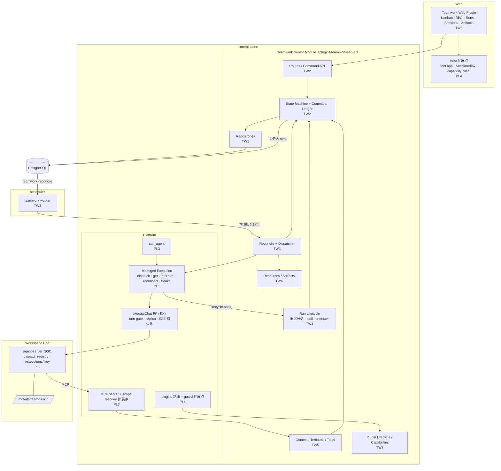

# 00 · 总体架构

## 1. 改造目标

从当前 Preview：

```text
Task → Coordinator Chat → call_agent → Member Chat
```

升级为：

```text
Task → WorkItem → Run → Managed Execution → Session → Runtime
```

建立持久化的 Task State、WorkItem State、Run State、Business Event、Command Idempotency、Resource State、Retry / Recovery 语义与 Human Acceptance。Teamwork 不再依赖 Chat Transcript 推导业务状态。

V2 的核心不是"让多个 Agent 互相聊天"，而是在 QAP 已有 Runtime 能力之上，建立**可持久化、可恢复、可审计、可验收**的任务编排系统。第一阶段优先保证：能发现问题、能保存事实、能阻止重复执行、能安全恢复；不追求第一版完全自动自治。

## 2. 两层边界

> **Platform** 负责"一次 Agent Execution 如何可靠发生"。
> **Teamwork** 负责"哪些 Execution 应该发生，以及它们对业务任务意味着什么"。

```text
Platform（PL 工作流）                 Teamwork（TW 工作流）
├─ admission (turn-gate)              ├─ task / work item
├─ dispatch + dispatch identity       ├─ workflow template / snapshot
├─ runtime adapter                    ├─ run（业务意义上的执行尝试）
├─ session / session token            ├─ retry decision / 分类
├─ reconnect / interrupt              ├─ dependencies
├─ execution facts（managed_executions）├─ acceptance（协调员 / owner）
└─ lifecycle hook bus                 └─ business state / events / commands
```

禁止事项：

- Teamwork 不得演变成第二套 Agent Runtime：不得直接 fetch agent `/chat`、不得自己消费 SSE、不得自己实现 reconnect、不得自己判断 runtime 状态。
- Platform 不得出现 Task Status、WorkItem Status、Kanban、Coordinator Accept、Owner Acceptance、Teamwork Retry Policy。
- Teamwork 不得出现 `if codex / if claude / if goose / if dsh`，只消费 Runtime Capability。
- Runtime Adapter 不知道 Task / WorkItem / Kanban 的存在。

## 3. 组件图



## 4. 领域模型

```text
Task
 └── WorkItem（Phase 2；Phase 1A 只有协调员 Run 直挂 Task）
       └── Run（一次执行尝试，Teamwork 业务对象）
             └── Managed Execution（平台执行事实，1:1 对应 Run）
                   └── Session（上下文容器，可被同一 WorkItem 的多个 Run 复用）
```

| 对象 | 回答的问题 | 生命周期 | 所有者 |
| --- | --- | --- | --- |
| Task | 用户要完成什么目标 | 跨多 Agent、多 Run、数小时到数天 | TW |
| WorkItem | 可以独立执行、独立验收的一块工作 | 跨多次 Run、返工 | TW |
| Run | 这一次尝试的业务意义（initial / continue / retry / rework） | 一个 Agent turn | TW |
| Managed Execution | 这一次执行在平台层实际发生了什么 | 一个 Agent turn | PL |
| Session | 对话上下文从哪里延续 | 跨多次 Run | PL |

关键区分：

- `Task != Chat != Session != Run`。
- `Run succeeded` 只表示 Agent turn 正常结束，**不意味着** WorkItem done 或 Task done。
- `sessions.chat_status` 是会话状态，**不是**执行状态，更不是业务状态。
- 同一 WorkItem 的续跑复用 Session A；因环境或恢复需要可以换到 Session B。Session 解决上下文连续性，Run 解决执行尝试，WorkItem 解决业务工作，Task 解决最终目标。

示例：

```text
WorkItem "API 回归"
  Run #1  retry     failed        (Session A)
  Run #2  retry     succeeded     (Session A)  → WorkItem submitted
  协调员 accept(result_run_id=#2)             → WorkItem done
```

## 5. 状态总览

详细转换表见 `02-contracts.md §3` 与 `ws-tw2-commands-api.md`。

| 层 | 状态 |
| --- | --- |
| Task | `backlog / ready / in_progress / blocked / in_review / done / cancelled` |
| Task.blocked_reason | `awaiting_input / paused / dependency / execution_failed / workspace_unavailable / resource_failed / permission_changed / budget_exhausted / execution_unknown / suspected_stall / no_decision` |
| WorkItem | `ready / running / submitted / blocked / done / cancelled` |
| Run | `queued / starting / running / waiting_input / succeeded / failed / interrupted / unknown` |
| Managed Execution | 与 Run 同名同义（Run 状态由 Execution 事实投影） |
| Plugin lifecycle | `active / draining / disabled` |
| Resource | `preparing / ready / releasing / released / failed` |

UI 文案：待规划、待执行、进行中、阻塞、待验收、已完成、已取消。

## 6. 端到端执行主线

```text
User Goal
  → Task(backlog) ─start→ Task(ready)
  → reconcile(task_id)                                  # 唯一自动推进器
      BEGIN; lock task; 检查 lifecycle / control_intent / 已有 Run
      INSERT Run(queued, dispatch_key=teamwork:{run_id}) # Durable Claim
      COMMIT
  → dispatchManagedTurn(dispatch_key)                   # 事务外
  → turn-gate admission → Runtime Adapter → Agent Session
  → Execution Facts（managed_executions）→ lifecycle hook
  → Run 终态 → reconcile
  → WorkItem submitted → Coordinator accept → WorkItem done
  → Coordinator submit_review → Task in_review
  → Owner accept(result_run_id, version) → Task done
```

三条铁律：

1. **先 claim 后 dispatch**：创建 queued Run 并 COMMIT 才算占位；绝不先 dispatch Agent 再建 Run。
2. **网络调用不持有 DB 事务**：锁内只做判定与写入，dispatch / interrupt / lookup 全部在事务外。
3. **不确定就停**：无法证明执行是否发生时进入 `unknown`，Task `blocked/execution_unknown`，只能人工 `resolve_execution`。

## 7. Reconcile 与 Scheduler 的关系

- `reconcile(task_id)` 是唯一自动推进器，在 CP 内执行（TW3）。
- scheduler 中的 teamwork worker 只消费**短** reconcile job 并调用 CP 内部端点；不持有贯穿任务的长 job，不写 Task 状态（I-12）。
- 唤醒来源：Task start、Run 生命周期变化、成员/协调员 report、用户回答、Retry 到期、Resume、Rework、资源状态变化、执行健康变化；另有约 60s 的周期 sweep，修复 worker 崩溃、队列丢失、服务重启、漏通知。
- 队列消息可重复；靠行锁、partial unique index、`dispatch_key`、`request_id`、`dedupe_key` 收敛。队列投递保证不等于模型与外部副作用 exactly-once。

## 8. 并发三层（禁止混用）

| 层 | 控制什么 | 由谁控制 | 默认 |
| --- | --- | --- | --- |
| Platform Admission | 真实 Runtime 容量：`ready replicas × max_concurrency` | turn-gate（PL） | 按 Workspace 配置 |
| Teamwork Parallelism | 一个 Task 同时跑几个成员 Run | reconcile（TW3） | `max_member_parallelism = 3` |
| Runtime Step Budget | 单次 turn 内的步数 | `workspace_config.max_steps`（migration 141） | 按 Workspace 配置 |

pg-boss worker 数量（`localConcurrency`）不是以上任何一层。协调员等待成员时**不运行轮询 turn**，因此不会因持槽同步等待造成同 Workspace 死锁。

## 9. 部署拓扑前提

- turn-gate 按**单 CP 进程**设计。V2.1 成立的前提是单活 CP；多个 scheduler 实例可以同时投递 reconcile。
- 多 CP 活跃副本需要先建设跨副本 turn admission 与流路由，不能凭 Run 表宣称平台已支持多 CP 并发安全。
- Teamwork Server Module 是受信任的第一方代码，CP 与 scheduler 启动时**静态注册**；Web bundle 可独立上传分发。不建设任意后端 npm 插件热加载。

## 10. 不变量（全体必须遵守）

每条不变量必须至少有一个自动化测试，测试 ID 见 `ws-qa-harness.md`。

| ID | 不变量 | 主要负责 |
| --- | --- | --- |
| I-01 | 创建 queued Run 即 Durable Claim；先 COMMIT 后 dispatch | TW3 |
| I-02 | 一个 WorkItem 最多一个 non-terminal Run（DB partial unique index） | TW1 |
| I-03 | 一个 Task 最多一个 non-terminal Coordinator Run（DB partial unique index） | TW1 |
| I-04 | 同一 `dispatch_key` 在同一 `runtime_instance_id` 内不得产生多个执行；跨实例重启无法证明时必须进入 unknown，不得重发 | PL1 / PL2 |
| I-05 | Execution succeeded ≠ WorkItem done ≠ Task done | TW4 |
| I-06 | WorkItem submitted 必须经协调员 accept 才能 done | TW2 |
| I-07 | Task done 必须经 owner accept，且携带当前 `result_run_id` 与 `version` | TW2 |
| I-08 | unknown Execution 不得自动 retry | TW4 |
| I-09 | suspected stall 在 Phase 1A 不得自动重新执行或自动中断 | TW4 |
| I-10 | UI / API 不得直接修改业务 status，只能发命令 | TW2 / TW8 |
| I-11 | Chat Transcript 不是 Teamwork 业务状态来源 | 全体 TW |
| I-12 | Scheduler Worker 不直接拥有 Task State Machine | TW3 |
| I-13 | Runtime Adapter 不知道 Task / WorkItem / Kanban | PL2 |
| I-14 | 网络调用期间不得持有 DB 事务 | 全体 |
| I-15 | 业务写入与 reconcile 入队在同一事务（pg-boss `SendOptions.db`） | TW2 / TW3 |
| I-16 | 同一 `(scope_key, request_id)` 的命令，无论顺序重放还是并发到达，都返回首次结果，不产生第二个动作 | TW2 |
| I-17 | 结果只能由绑定的当前 Run 写入；迟到、取消后、旧 Run 的结果只进历史，不改变当前状态 | TW4 / TW5 |
| I-18 | pause / cancel 意图优先于完成事件；停止未确认前不得显示已暂停 / 已取消 | TW2 / TW4 |
| I-19 | 一个 Session 只属于一个 Task 或一个 WorkItem，不得跨任务复用 | TW1 |
| I-20 | lifecycle hook 至少一次投递，处理必须幂等；hook 丢失由 sweep 兜底 | PL1 / TW4 |
| I-21 | 授权由服务端按 task 关系重新检查；拿到 workspace_id / session_id 不等于可读 | TW2 / TW5 |
| I-22 | 插件后台是否可执行只由 `teamwork_plugin_settings.lifecycle` 决定，不看 `plugins.enabled` | TW7 |
| I-23 | 每个终态 Run 的业务后果被应用**恰好一次**：由持久化的 `outcome_applied_at` 标记，与业务转换同事务写入；不依赖"reconcile 看到状态变化的那一刻" | TW3 / TW4 |
| I-24 | 发送权与取消权原子二选一：取消获胜即保证从未发送；发送获胜则按在途执行等待真实停止 | PL1 |
| I-25 | 写工具调用必须携带本轮 `run_ref`，且等于该 session 当前非终态 Run 的 id，否则拒绝；终态不确定的 Run 之后，下一个 Run 必须换新 Session | TW3 / TW5 |
| I-26 | 命令幂等重放之前必须先通过当前调用者对该 task 的授权 | TW2 |
| I-27 | runtime 返回 404 不是"未接受"的证据；只有 fence 回执或 412 实例不匹配可以证明 | PL1 / PL2 / TW4 |
| I-28 | 提交有效（§3.5 第一步）之后、进入 in_review 之前，不派发任何 Run | TW3 |
| I-29 | 发送权竞争失败的一方只读取、不写执行状态；"UPDATE 影响 0 行"不等于已取消 | PL1 |
| I-30 | 每个 task 的每类资源（task 级或 workspace 级）至多一个当前资源行（非 orphan_suspected），由 DB 约束保证 | TW1 / TW6 |
| I-31 | Run 中由执行派生的字段只由 `projectFromExecution` 根据 `managed_executions` 当前行写入，按 seq 单调；Run 终态后不再改变；dispatch、reconcile、命令都不直接写 Run 的执行终态 | TW3 / TW4 |
| I-32 | 执行终态是吸收态：`managed_executions` 的任何写入路径都不能把终态改成其他状态；同一 dispatch_key 终态后只读，重试必须换新 Run 与新 dispatch_key | PL1 |
| I-33 | 同一资源的外部操作只能在有效租约内执行；只有租约过期的 `preparing` 才能判定为孤儿；过期操作的结果不得落库，也不得继续后续步骤 | TW6 |
| I-34 | **R4**：对外部系统的写操作，要么在外部按操作身份定位和隔离（dispatch_key / op_id），要么在结果不确定时标记为 `uncertain`，直到拿到旧操作已终止的证据再继续。DB 条件写入不能替代外部确认；修改共享状态的操作不能凭租约过期接手。**等待时间不是证据；降级 capability 不能代替满足安全性**（D-54） | PL1 / PL2 / TW6 |
| I-35 | 托管执行的中断一律按 dispatch_key 定位，由 agent-server 原子地"匹配执行身份 + 发出中断"；不得使用不带执行身份的 session 级中断 | PL1 / PL2 |
| I-36 | 同一挂载点存在 `uncertain` 的操作时，不得发起任何新的挂载修改操作；`uncertain` 只能凭"旧操作已终止"的证据解除（AFS 服务端操作序号拒绝、人工确认）；观察结果、等待时间、组件实例变更都不是证据 | TW6 |
| I-37 | 执行级中断的隔离性是硬性前提：不得中断目标以外的执行。隔离不能靠降级 capability 来处理；做不到隔离的 runtime 不得接收托管执行 | PL1 / PL2 |

## 11. 与 Symphony 的映射

| Symphony | QAP V2.1 | 差异说明 |
| --- | --- | --- |
| Issue（tracker 为事实来源） | Task（PostgreSQL 为事实来源） | 首版不接外部 tracker |
| 内部 claim 状态 `Unclaimed/Claimed/Running/RetryQueued/Released` | queued Run 占位 + `next_run_at` + 业务态释放 | 持久化而非内存 |
| Run Attempt | Run | 一轮一个 Run，便于恢复 |
| Live Session | Session + Managed Execution | 执行事实下沉平台 |
| 编排器唯一写入 | State Machine 唯一写入 | 同 |
| Tick：reconcile → 预检 → 候选 → 排序 → 派发 | `reconcile(task_id)`：同顺序，按 task 粒度 | 事件唤醒 + sweep 替代固定轮询 |
| `agent.max_turns=20`，续轮只发续跑指引 | `max_coordinator_turns=20`，`continue` Run 复用 Session 只发续跑指引 | 同 |
| 正常退出 1s 续跑复查；失败 `min(10s·2^(n-1), 300s)` | continuation 不计重试；1A 失败重试固定 10s / 30s / 120s，仅限 confirmed retryable | 更保守 |
| `stall_timeout_ms` → kill + retry | 1A 只检测 → 查询 → `suspected_stall` 阻塞；Phase 3 才自动恢复 | 多 runtime 下更安全 |
| per-issue workspace + hooks | AFS 目录 + 受控资源步骤（`teamwork_resources`） | 不允许任意 shell |
| `WORKFLOW.md` 热加载 | Workflow Template + start 时冻结 `workflow_snapshot` | 已启动任务不改协议 |
| provider-native agent tools（宿主侧执行，凭证不下发） | Teamwork MCP 工具（身份来自 session 绑定） | Agent 提交意图，状态机决定迁移 |
| workpad 单一持久评论 | `teamwork_tasks.workpad` | 结构化 JSON |
| `Human Review` 交接 | `in_review` + owner accept | 同 |
| user-input 不得无限挂起 | waiting_input 显式呈现 + 通知；Phase 3 增加超时策略 | 见决策 D-12 |

不照搬：内存事实来源、固定间隔轮询、Codex app-server 直连、宿主机进程管理、自动合并 PR、任意 shell hooks、WORKFLOW.md 热加载、外部 tracker 同步。

## 12. 明确不做（本轮）

任意后端插件热安装；无限递归 WorkItem；Workflow Graph / DAG 编辑器；自定义 Kanban 状态；exactly-once 外部副作用；跨用户 Managed Teamwork；自动 Merge PR；每 Task 独立容器；完全自治恢复；LLM 自动决定 owner 验收；外部 tracker 双向同步；旧 Preview 数据兼容层或自动迁移。
