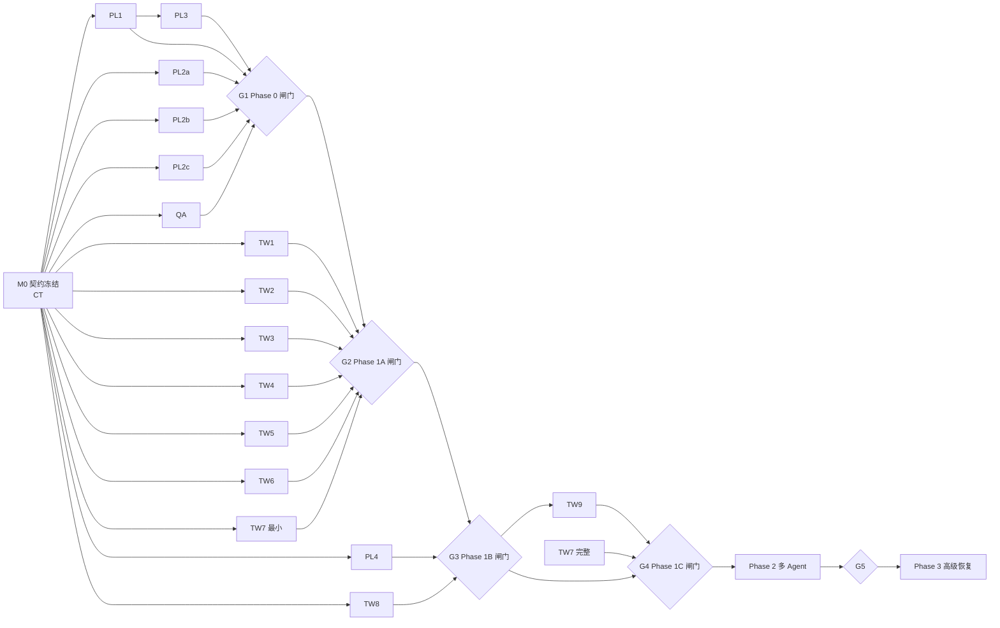

# 03 · 并行开发计划

## 1. 角色

| 角色 | 职责 |
| --- | --- |
| INT 集成者（人或主 Agent） | 维护 `02-contracts.md`；分配 migration 编号；合并契约 RFC；拥有注册入口等热点文件；执行集成闸门；按顺序合并各工作流分支 |
| CT 契约工作流 | M0 前落地 `internal/types/managed-execution.ts`、`plugins/teamwork/contracts/*`、`plugins/teamwork/server/ports.ts`、fake 实现骨架 |
| PL1–PL4 | 平台工作流 |
| TW1–TW9 | Teamwork 工作流 |
| QA | 测试基础设施与验收矩阵 |

## 2. 工作流一览

| WS | 名称 | Phase | 依赖（契约以外） | 可用 fake 并行？ |
| --- | --- | --- | --- | --- |
| CT | 契约与 fake | M0 | — | — |
| PL1 | Managed Execution 核心 | 0 | CT | 是 |
| PL2 | agent-server 执行身份（PL2a claude-code / PL2b acp-adapter: codex+goose / PL2c dsh） | 0 | CT | 是，三个子流互相独立 |
| PL3 | call_agent 收敛 + MCP scope 扩展点 | 0 | PL1 合入 | 扩展点部分可先做 |
| PL4 | Web host 扩展点 + 插件路由 guard | 1B / 1C | CT | 是 |
| TW1 | schema / migration / repos | 1A | CT | 是 |
| TW2 | 状态机 / 命令账本 / API | 1A | CT（repo 用 fake） | 是 |
| TW3 | reconcile / dispatcher / worker | 1A | CT（repo、execution 用 fake） | 是 |
| TW4 | Run 生命周期 / 重试分类 / stall / unknown | 1A | CT | 是（纯判定为主） |
| TW5 | Context / 模板 / workpad / MCP 工具 | 1A | CT；PL3 扩展点接口 | 是 |
| TW6 | 资源与产物 | 1A | CT | 是（AFS 用 fake） |
| TW7 | 插件生命周期 / 协议 / capabilities | 1A 最小 + 1C 完整 | CT；PL4 guard 接口 | 是 |
| TW8 | Web 插件 UI | 1B | CT；PL4 | 是（API 用 mock） |
| TW9 | 旧实现迁出与删除 | 1B 末 / 1C | TW2、TW5、TW8 合入 | 否 |
| QA | fake agent-server、故障注入、验收用例 | 0 起 | CT | 是 |

## 3. 依赖 DAG 与里程碑

关键规则：**开发可以并行，集成必须按闸门顺序**。

- TW 工作流可以在 G1 之前用 fake `ExecutionPort` 完成开发和单元测试，但**不得在 G1 通过前接入真实 `dispatchManagedTurn`**。
- TW8 可以在 G2 之前用 mock API 开发，但 **G2 未通过不得合入 main 的可见入口**（V2.0 §58：禁止先做 Kanban 再补可靠执行）。
- Phase 2 的 WorkItem 相关代码可以提前写在 feature flag 后，但 G4 前不得开启。

## 4. 集成闸门

| 闸门 | 合入内容 | 必须通过 |
| --- | --- | --- |
| G1 Phase 0 | PL1、PL2abc、PL3、QA harness | QA：F-01～F-14、F-16～F-18（**F-17 为硬性项，每个 runtime 单独通过**）；PT-01；I-24、I-27、I-29、I-32、I-35、I-37 测试；I-04、I-14、I-20 测试；普通 Web chat / API chat / scheduler / connector / call_agent 回归通过；四种 runtime 输出一致的 Execution Facts |
| G2 Phase 1A | TW1–TW7 最小（代码合入 main，**生产装配不注册**） | QA：A-01～A-37（含 A-01a～c、A-10b、A-33b～d）；PT-02、PT-03；I-25、I-28、I-30、I-31、I-33、I-34、I-36 测试；I-01～I-03、I-05、I-07～I-12、I-15～I-19、I-21、I-22 测试。全部在**测试装配**（§4.1）中运行；生产 CP 仍只挂载旧实现 |
| G3 Phase 1B | PL4 host 部分、TW8（代码合入 main，插件 bundle 不上传生产） | QA7-U：U-01～U-10，在测试装配（WP-INT4 + WP-QA4）+ TW8a 产出的测试 bundle 下运行；生产仍是旧 UI |
| G4 Phase 1C | TW7 完整、PL4 guard、装配（WP-INT4 / INT4b）、TW9 **原子切换候选 PR**（§4.2） | QA：L-01～L-06、L-08（切换前，在测试装配中）；L-07 与切换 / 回滚演练（在切换候选 PR 的预发部署上）。**G4 通过后才合并切换 PR**；合并后只有新实现在服务，不存在两套 Teamwork（D-61） |
| G5 Phase 2 | WorkItem 全链路 | QA：M-01～M-10；PT-02 覆盖 WorkItem 事件 |

闸门由 INT 执行；每个闸门输出一份 `docs/teamwork-v2/gates/Gx-report.md`（测试结果、未通过项、遗留 TODO）。

### 4.1 G4 之前：只在测试装配中运行新实现（D-35）

新旧实现使用同一 URL `/api/teamwork`，不能同时挂载；旧 UI 也不满足新的协议头与命令契约。因此 G4 之前：

- `registerTeamwork(deps)` 已合入 main，但**生产**的 `control-plane/src/index.ts` 与 `scheduler/src/index.ts` **不调用**它，生产继续挂载旧 `routes/teamwork.ts`。
- QA 维护一个测试装配入口 `control-plane/e2e/teamwork/app.ts`：只注册新实现（新路由、TW5 scope resolver、teamwork worker），不挂载旧路由，连接独立测试库。G2、G3 的全部验收在这里运行。
- 新表（migration 143、144）可以提前在生产库执行；旧代码不读写新列，写入时取默认值。`teamwork_sessions_session_uq` 唯一索引**推迟到切换 migration**（编号 146），因为旧 Preview 数据可能存在重复 session，需要在切换前人工确认。
- 不设 feature flag 让两套实现在同一进程里二选一，也不写兼容层。

### 4.2 G4：原子切换

切换 PR 分两步（D-61），避免"切换前必须先通过切换后的验收"：

1. G3 通过后，INT 开**候选 PR** 并部署到预发；
2. QA7-L 的切换候选段（L-07 与切换 / 回滚演练）在预发上通过 → G4 → INT **合并**候选 PR。

切换 PR 同时完成以下内容（`index.ts` 调用的是 WP-INT4 实现的同一个 `registerTeamwork`，测试装配用的也是它，D-60）：

1. `control-plane/src/index.ts`：删除旧 `/api/teamwork` 挂载，调用 `registerTeamwork`；
2. `scheduler/src/index.ts`：注册 teamwork worker；
3. `mcp/server.ts`：删除 `legacyTeamworkScope`，由 TW5 resolver 生效（PL3）；
4. `useFleetApps.ts`、`wsApps.tsx`：删除内置 Teamwork 入口（PL4 / TW9）；
5. 删除旧 Teamwork 路由、服务、DB 模块与 UI（TW9 删除清单）；
6. migration 146：`teamwork_sessions_session_uq` 与其他切换期约束；
7. 部署后管理员上传插件 bundle，并通过 `plugin/commands` 设为 active。

切换前在预发环境完整演练一次：执行切换 PR → 旧 Preview 任务在新看板中显示为待规划 → 能开始并完成一个新任务 → 回滚演练（回滚到切换前版本时，新表保留但不被读取）。

## 5. 文件所有权

原则：一个文件在同一时间只有一个工作流拥有写权限。其他工作流需要改动时，提交"变更请求"（在 PR 描述中写明需要的函数签名 / 行为），由所有者实现。

| 路径 | 所有者 | 备注 |
| --- | --- | --- |
| `internal/types/managed-execution.ts` | CT → 冻结后 INT | |
| `internal/types/events.ts` | CT | 只加可选字段 |
| `plugins/teamwork/contracts/**`、`server/ports.ts` | CT → 冻结后 INT | |
| `control-plane/src/services/execution/**`（新建） | PL1 | Managed Execution 实现；按 `04-task-board.md §5.2` 拆给 WP-PL1a～e，各 WP 只写其中各自的文件（D-58） |
| `control-plane/src/services/chat/executeChat.ts`、`dispatchChatTurn.ts`、`turn-gate.ts` | PL1 | 热点，PL3 不得直接改 |
| `control-plane/src/lib/sse.ts`、`lib/sse-aggregate.ts`、`lib/session-recovery.ts` | PL1 | 热点 |
| `control-plane/src/services/replica-router.ts` | PL1 | 只读使用为主 |
| `control-plane/migrations/142_*` | PL1 | |
| `agents/claude-code/**` | PL2a | |
| `internal/acp-adapter/**`、`agents/codex/**`、`agents/goose/**` | PL2b | |
| `internal/dsh-adapter/**`、`agents/dsh/**` | PL2c | |
| `control-plane/src/mcp/server.ts`、`mcp/tools.ts`、`mcp/tools/agent.ts` | PL3 | Teamwork 专用分支由 PL3 移除 |
| `control-plane/src/mcp/scope-registry.ts`（新建） | PL3 | |
| `web/src/lib/host.ts`、`web/src/plugins/types.ts`、`registry.ts`、`web/src/lib/plugin-loader.ts`、`plugin-lazy-registry.ts`、`web/src/hooks/useFleetApps.ts` | PL4 | |
| `control-plane/src/routes/plugins.ts`、`services/db/plugins.ts` | PL4 | 增加 guard 扩展点 |
| `control-plane/migrations/143_* 144_* 145_*` | TW1 | |
| `plugins/teamwork/server/db/**` | TW1 | |
| `plugins/teamwork/server/state-machine.ts`、`commands.ts`、`routes.ts` | TW2 | |
| `plugins/teamwork/server/reconcile.ts`、`dispatcher.ts`、`plugins/teamwork/worker/**` | TW3 | |
| `plugins/teamwork/server/run-lifecycle.ts`、`retry.ts`、`health.ts` | TW4 | |
| `plugins/teamwork/server/context.ts`、`tools.ts`、`plugins/teamwork/templates/**` | TW5 | |
| `plugins/teamwork/server/resources.ts`、`artifacts.ts` | TW6 | |
| `plugins/teamwork/server/lifecycle.ts`、`capabilities.ts`、`plugin.json` | TW7 | |
| `plugins/teamwork/web/**` | TW8 | |
| `control-plane/src/routes/teamwork.ts`、`services/teamwork.ts`、`services/db/teamwork.ts`、`web/src/components/teamwork/**`、`web/src/components/shell/apps/wsApps.tsx` 中 Teamwork 部分、`web/src/lib/api/client.ts` 中 Teamwork 方法 | TW9 | G3 前冻结，不得新增功能 |
| `control-plane/src/index.ts`、`scheduler/src/index.ts`、`plugins/teamwork/server/index.ts`、根 / 包 `package.json`、`tsconfig` 引用 | INT | 注册行由 INT 统一加 |
| `control-plane/e2e/teamwork/**`、`test/fakes/**` | QA | |

`plugins/teamwork/` 是新 workspace 包，由 CT 在 M0 建立骨架（`package.json`、`tsconfig`、目录、空 index），并由 INT 接入 CP / scheduler / web 的构建。

## 6. 分支与契约变更协议

1. 每个**工作包**一个 git worktree，分支名 `tw2/<wp-id>-<slug>`，例如 `tw2/wp-pl1b-dispatch-core`（与 `04 §3` 一致）。
2. 每日 rebase `main`；只有 INT 合并到 `main`。
3. **合并顺序以 `04-task-board.md` 为准**：每个 WP 在其开工依赖与合入依赖全部合入后即可合并（`04 §5` 卡片、`§6` 依赖图）。本文件不再规定线性合并顺序（D-63）。§4 的 Phase 与闸门只定义**验收**顺序，不约束 WP 的合并顺序；例如 QA1 先于 PL1b 合入、PL4c 在 G2 之前合入，都是正确的。
4. **契约 RFC**：需要改动 `02-contracts.md` 或冻结类型时，提交单独 PR，标题 `[contract-rfc]`，写明动机、影响的工作流、兼容性；INT 批准后先合入，再由依赖方 rebase。
5. 禁止在非所属文件中"顺手修一下"。发现问题时在 PR 描述中列出，交给所有者。
6. 每个 PR 必须能独立通过 `npm test`（对应包）与 biome；不能依赖尚未合入的其他工作流代码（用 fake）。

## 6.1 派发

实际派发以 `04-task-board.md` 的工作包为单位，不按单个任务派发。本文件的工作流划分、文件所有权、闸门仍然有效；工作包卡片中的"只写文件"是工作流所有权的进一步细分。

## 7. 每个工作流的交付模板

每次 PR（或每个阶段结束）在 PR 描述中提供：

1. **当前代码映射**：涉及的现有模块及标记（KEEP / EXTEND / EXTRACT / REPLACE / DELETE-LATER）
2. **本次修改范围**：文件列表，确认都在自己的所有权内
3. **DB migration**：编号、内容、是否可重复执行
4. **状态机变化**：新增或修改的转换
5. **新增 / 覆盖的不变量**：I-xx 列表
6. **新增 tests**：单元、集成、故障注入
7. **crash / retry / concurrency 测试结果**：命令与输出摘要
8. **尚未实施的 TODO**：以及原因
9. **踩坑**：新发现的陷阱，追加到 `90-pitfalls.md`（通过 PR 提交）

不得仅以"功能可以运行"作为验收标准。

## 8. 初始代码映射（开工第一步需各所有者复核）

V2.0 §63 要求在大规模改代码前输出映射报告。以下为 INT 基于 `main@80361d0` 的初稿；各工作流开工首个 PR **只提交复核后的映射**（可修正标记），不改代码。

| 模块 | 路径 | 标记 | 负责 | 说明 |
| --- | --- | --- | --- | --- |
| executeChat | `control-plane/src/services/chat/executeChat.ts` | EXTRACT | PL1 | 抽出 admission → autostart → session 校验 → replica → token → POST /chat → SSE 持久化的核心为 Managed Execution；现有 HTTP 行为不变 |
| dispatchChatTurn | `services/chat/dispatchChatTurn.ts` | EXTEND | PL1 | stream / async / sync 三种模式改为调用 Managed Execution |
| drainPendingMessage | `services/chat/executeChat.ts:267` | EXTEND | PL1 | 增加 `disablePendingDrain` 开关（D-15） |
| turn-gate | `services/chat/turn-gate.ts` | KEEP | PL1 | 单进程；只读取，不改语义 |
| replica-router | `services/replica-router.ts` | KEEP | PL1 | lookup 需按 `replica_ordinal` 路由 |
| session-token | `lib/session-token.ts` | KEEP | — | 继续按 session 复用。工具调用的 Run 归属由 Teamwork 的 `run_ref` 比对解决（`02 §9.1`） |
| SSE 持久化 | `lib/sse.ts`、`lib/sse-aggregate.ts` | EXTEND | PL1 | 写 `managed_executions` 事实与 seq，发 lifecycle 事件 |
| session recovery | `lib/session-recovery.ts` | EXTEND | PL1 | 启动时先恢复 managed_executions，再恢复孤儿 session；不再只依赖 `chat_status='agent'` |
| call_agent | `mcp/tools/agent.ts` | EXTRACT → REPLACE | PL3 | `runSubAgentTurn` 的直接 fetch 改为 `dispatchManagedTurn(origin='call_agent')`；保留 foreground / background 语义与 `FOREGROUND_WAIT_MS=30s` |
| roster 扩展查找 | `mcp/tools/agent.ts:588` `resolveRosterMemberBySlug` | DELETE-LATER | PL3 / TW9 | Managed Teamwork 禁用 call_agent 后此路径无用 |
| MCP task 作用域 | `mcp/server.ts` `findTaskBySession` | REPLACE | PL3 | 改为通用 scope resolver 注册表，Teamwork 通过 TW5 注册 |
| runtime：claude-code | `agents/claude-code/src/server.ts`（`SessionSink`） | EXTEND | PL2a | dispatch registry、lookup、info、interrupt confirm |
| runtime：ACP | `internal/acp-adapter/acp-server.ts`、`acp-bridge.ts` | EXTEND | PL2b | registry 与 bridge LRU 分离 |
| runtime：goose | `agents/goose/src/server.ts`、`session-store.ts` | EXTEND | PL2b | 注意 `SessionIdCodec` |
| runtime：dsh | `agents/dsh/src/runtime/platform-server.ts`、`internal/dsh-adapter/*` | EXTEND | PL2c | 已有 resume / cancel，映射到统一契约 |
| 事件协议 | `internal/types/events.ts` | EXTEND | CT | 可选字段 |
| plugin host | `web/src/lib/host.ts` | EXTEND | PL4 | apps、SessionView、capability client |
| plugin types / registry | `web/src/plugins/types.ts`、`registry.ts` | EXTEND | PL4 | 增加 `apps`；tool handler 保持纯刷新语义 |
| plugin loader | `web/src/lib/plugin-loader.ts`、`plugin-lazy-registry.ts` | EXTEND | PL4 | fleet app 占位懒加载；版本不匹配显式报错 |
| useFleetApps | `web/src/hooks/useFleetApps.ts` | EXTEND → 删硬编码 | PL4 / TW9 | 合并插件 app；G4 删除 `TeamworkApp` 硬编码 |
| useWsApps | `web/src/hooks/useWsApps.ts` | KEEP | — | Teamwork 首页入口不再依赖它 |
| wsApps | `web/src/components/shell/apps/wsApps.tsx` | DELETE-LATER（Teamwork 部分） | TW9 | |
| plugins 路由 / DB | `control-plane/src/routes/plugins.ts`、`services/db/plugins.ts` | EXTEND | PL4 | guard 扩展点；bundle URL 版本必须命中实际内容 |
| Teamwork routes | `control-plane/src/routes/teamwork.ts` | REPLACE → DELETE-LATER | TW2 / TW9 | 新实现同 URL，由插件注册；旧文件 G4 删除 |
| Teamwork 服务 | `control-plane/src/services/teamwork.ts` | EXTRACT → DELETE-LATER | TW6 / TW9 | AFS 调用抽到 TW6 |
| Teamwork DB | `control-plane/src/services/db/teamwork.ts` | EXTRACT → DELETE-LATER | TW1 / TW9 | `listRosterCandidates` 逻辑迁入 TW1 |
| Teamwork UI | `web/src/components/teamwork/TeamworkSection.tsx`（1366 行）、`TeamworkTimeline.tsx` | REPLACE → DELETE-LATER | TW8 / TW9 | Timeline 可复用部分移入插件 |
| Teamwork API client | `web/src/lib/api/client.ts` Teamwork 方法 | DELETE-LATER | TW9 | |
| Teamwork 类型 | `internal/types/api.ts` Teamwork 定义 | REPLACE | CT / TW9 | 改由 plugin contracts 拥有 |
| scheduler 主入口 | `scheduler/src/index.ts` | EXTEND | INT（注册）/ TW3（worker） | |
| scheduler handler | `scheduler/src/handler.ts` | KEEP | — | Teamwork 不使用 `agent-session` 队列 |
| pg-boss 发送 | `control-plane/src/lib/jobs.ts` | EXTEND | TW3 | 增加事务内 send helper（`SendOptions.db`） |
| AFS | `control-plane/src/services/afs.ts` | KEEP | — | TW6 通过现有接口调用 |
| 用量账本 | `workspace_usage_events` | KEEP | — | 按 run / session 去重展示 |
| 审批 / 通知 | `agent_requests`、`/api/notifications/*` | KEEP | — | 等待输入与待验收通知 |
| 文档站 | `docs-site/src/content/docs/{,zh-cn/}concepts/teamwork.md` | REPLACE | TW9 | 当前写了"任务结束回收"，与代码不符 |
