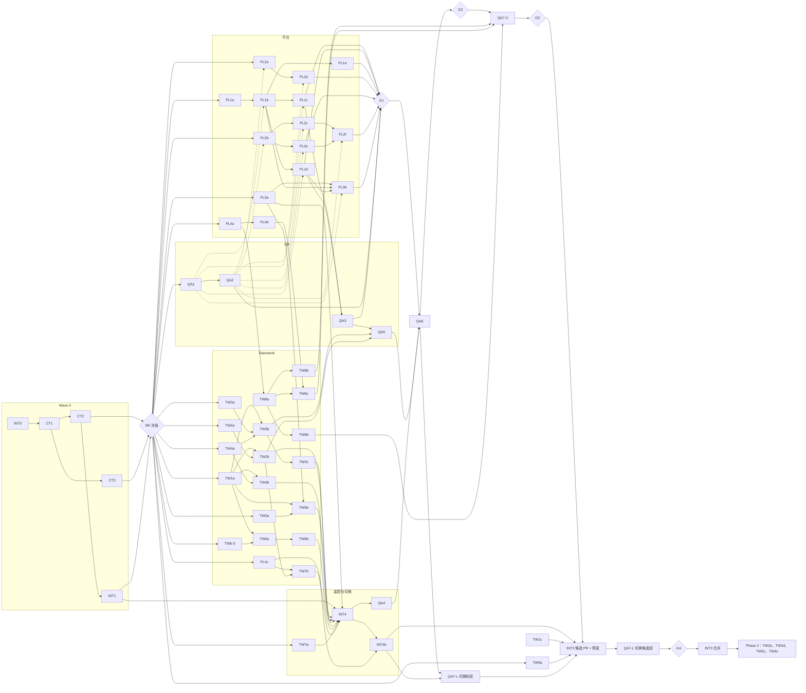

# 04 · 任务板：可派发的工作包

本文件是**派发给 Agent 的唯一索引**。`ws-*.md` 解释"为什么、怎么做"；本文件规定"派给谁、何时能开工、改哪些文件、怎样算完成"。两者冲突时，以 `02-contracts.md` 为准，并提交契约 RFC。

## 1. 派发单位：工作包（WP）

派发单位是**工作包**，不是 `ws-*.md` 里的单个任务。原因是同一个工作流里的多个任务往往改同一组文件，拆给多个 Agent 会互相冲突。每个 WP 满足：

- **独立**：只依赖已合入 main 的 WP，或 CT 提供的契约与 fake；
- **文件不重叠**：同一时刻没有两个进行中的 WP 写同一个文件；
- **可验证**：有明确的验证命令与断言；
- **大小**：S ≈ 0.5～1 天，M ≈ 2～3 天，L ≈ 4～5 天（按一个 Agent 的工作量估计）。

WP 编号：`WP-<工作流><序号>`，例如 `WP-PL1b`。卡片中"任务"一列引用 `ws-*.md` 的任务编号。

## 2. Agent 派发模板

派发每个 WP 时，把下面的模板填好后交给 Agent。

```text
你负责工作包 {WP-ID}：{标题}。

【必读】
- docs/teamwork-v2/00-architecture.md（全局边界与不变量）
- docs/teamwork-v2/02-contracts.md 的 {章节}
- docs/teamwork-v2/{ws 文档} 的 {章节}
- docs/teamwork-v2/90-pitfalls.md 中的 {P 编号列表}

【前置】以下 WP 已合入 main：{依赖列表}。若发现前置不满足，停止并报告，不要自行补做。

【只允许写这些路径】{文件列表}
其他文件一律只读。需要改动其他文件时，在 PR 描述中写"变更请求"，由该文件所有者处理。
不得修改 02-contracts.md 或冻结的契约类型；发现契约问题时提交 [contract-rfc] 说明。

【交付】{交付物}
【完成标准】{完成标准}
【验证命令】{命令}，并在 PR 中贴出输出摘要。

【必须覆盖的不变量 / 测试】{I-xx}、{测试编号}

【PR 描述必须包含 03-parallel-plan.md §7 的 9 项】：
代码映射、修改范围、migration、状态机变化、不变量、新增测试、
crash/retry/concurrency 结果、未完成 TODO、新发现的踩坑。
不得仅以"功能可以运行"作为完成标准。
```

## 3. 通用规则

- 分支名：`tw2/<wp-id>-<slug>`，例如 `tw2/wp-pl1b-dispatch-core`；每日 rebase main；只有 INT 合并。
- 每个 PR 必须能单独通过所属包的测试与 lint：
  - control-plane：`cd control-plane && npm test`，`npx biome check src`
  - web：`cd web && npm test`
  - scheduler：`cd scheduler && npm test`（如有）
  - agents / internal：各自目录下的测试命令
  - plugins/teamwork：CT 在 WP-CT1 中建立 `npm test`
- 不能依赖未合入的 WP。需要时使用 CT 提供的 fake。
- **规则 R-WP：完成标准必须能在本 WP 范围内运行**（D-59，P-174）。
  1. 依赖分三类：开工依赖（开工前已合入）、合入依赖（并行开发，但它们合入前本 WP 不能合入）、闸门依赖（只在闸门需要）。
  2. 完成标准只能使用"开工依赖 + 合入依赖"范围内能运行的测试。不得引用：后续 WP 才实现的功能、后续 WP 才提供的 runner、只有测试装配或闸门才具备的环境。
  3. WP 卡片中的 A / L / M 场景编号指它的 **fake 级变体**（`FakeExecutionPort` / `FakeAfs` / `InMemoryRepos` / `FakeClock`）；真实环境下的完整版本由 QA6、QA7 在闸门执行。
  4. 某个 WP 合入后，生产入口不能调用到尚未实现的方法。需要分步切换的入口，在卡片中写明由哪个 WP 切换。
  5. 修改任务板时，卡片、依赖图（§6）、波次（§7.1）、关键路径（§7.2）、Agent 分配（§7.3）必须在同一个 PR 中同步。
- migration 编号只用 `02-contracts.md §12` 中已分配给本 WP 的编号。
- 发现新踩坑时，在 PR 中追加到 `90-pitfalls.md`（编号由 INT 合并时分配）。
- 契约变更：先合入 `[contract-rfc]` PR，**同一个 PR 必须同步更新 `02 §5` 的 ports**（P-173）；依赖方再 rebase。

## 4. 共享 fake 规格（WP-CT3 / WP-QA1 交付）

各 TW 工作流并行开发时都依赖 fake。如果每个 Agent 各写一套，测试结果就没法对照。所以 fake 只由 CT 与 QA 提供，并按下表实现故障开关。

| fake | 提供方 | 必须支持的行为与开关 | 主要使用方 |
| --- | --- | --- | --- |
| `FakeExecutionPort`（内存） | CT | 完整实现 `ExecutionPort`；脚本化执行事件（started / waiting_input / terminal / unknown）；开关：同 key 并发 dispatch、发送权与取消竞争、发送前失败（admission / workspace_start）、事件乱序（旧 seq 晚到）、hook 重复 / 丢失、interrupt 五种结果、resolve 的 applied / already_terminal / probe_unconfirmed；记录每个 key 的真实发送次数 | TW2、TW3、TW4、TW5 |
| `FakeAfs`（内存） | CT | `createDir / mount / unmount / revokeDir`；开关：调用挂起直到手动释放、挂起后迟到生效（包括在"实例重启"之后生效）、返回成功但不生效、按序号拒绝（模拟 Q-07）；`probeMounts` 返回可配置的实际状态；记录外部调用次数与最终挂载目录 | TW6、TW2 |
| `InMemoryRepos` | CT 初版，TW1 维护 | 实现 `TeamworkRepos`；与真实 PostgreSQL 实现跑**同一套** contract test（`plugins/teamwork/server/db/__contract__`）；模拟 partial unique index 与 `ON CONFLICT` 语义 | TW2、TW3、TW4、TW6 |
| `FakeClock` | CT | 可推进的时间；用于 stall、租约过期、重试排期 | TW3、TW4、TW6 |
| `FakeQueue` | CT | 记录 send（含事务内 send 是否随回滚撤销）、`startAfter`、singletonKey 合并 | TW2、TW3 |
| `FakeMcpServer` | CT | 记录注册的工具与 disabledTools；可模拟带 / 不带 `run_ref` 的调用 | TW5、PL3 |
| fake agent-server（HTTP） | QA | 完整实现 `02 §2` 的 HTTP 契约：dispatch registry 两层、fence、412、执行级中断五种结果、`interruptTargeted / interruptConfirm`；脚本化 turn；开关：断连、重启（换 `runtime_instance_id`）、registry 淘汰、cancel 与下一轮交错、只送达不终止 | PL1、PL3、QA |

fake 的行为以 `02-contracts.md` 为准。fake 与契约不一致时，修 fake，不改契约。

## 5. 工作包卡片

列说明：

- **开工依赖**：必须已合入 main 才能开工；
- **合入 / 闸门依赖**：写法为 `合入：…；闸门：…`。
  - 合入依赖：本 WP 可以并行开发，但这些 WP 合入之前，本 WP 不能合入（通常是因为完成标准要用到它们提供的真实 runner 或实现）；
  - 闸门依赖：只在闸门集成测试中需要，本 WP 自己用 fake 验证；
- **只写文件**：本 WP 唯一可写的路径，其余只读；
- **完成标准**：只使用"开工依赖 + 合入依赖"范围内就能运行的测试（§3 规则 R-WP）。卡片中出现的 A / L / M 场景编号都是指 fake 级变体，完整版本由 QA6 / QA7 在闸门执行。

### 5.1 Wave 0：契约与骨架（M0 前，串行为主）

| WP | 内容 | 开工依赖 | 只写文件 | 完成标准与验证 | 规模 |
| --- | --- | --- | --- | --- | --- |
| WP-INT0 | 分配 migration 编号（`02 §12`）；建立 `tw2/*` 分支保护与 PR 模板（`03 §7` 九项） | — | `.github/`、`docs/teamwork-v2/03-parallel-plan.md` | 模板生效 | S |
| WP-CT1 | `plugins/teamwork/` 包骨架（package.json、tsconfig、`npm test`、目录与空 index）；`internal/types/managed-execution.ts`（`02 §1.1` 全部类型）；`internal/types/events.ts` 可选字段 | WP-INT0 | `plugins/teamwork/{package.json,tsconfig.json,README.md}`、`internal/types/managed-execution.ts`、`internal/types/events.ts` | `tsc --noEmit` 通过；类型与 `02 §1.1` 逐项一致 | M |
| WP-CT2 | `plugins/teamwork/contracts/*`（task、work-item、run、result、commands、capabilities、template、constants、tracker 预留类型，**以及 `tx.ts` 的 `Tx` / `WithTx` 类型**，D-62）；`server/ports.ts`（`02 §5` 全部接口，含 2.2.7 修正；`Tx` 从 `../contracts/tx` 导入） | WP-CT1 | `plugins/teamwork/contracts/**`、`plugins/teamwork/server/ports.ts` | `tsc` 通过，且 `ports.ts` 只从 `contracts/` 与 `internal/types/` 导入（加一条 lint 或测试检查，不得导入 `server/` 下实现文件）；`02 §5` 列出的 ports 引用类型全部定义；ports 与 `02 §5` 逐项一致，包括 `ExecutionPort` 含 `resolveManagedExecution`、`RunLifecycle` 的 `requestResolution / applyPendingResolution`、`ResourceManager.continueAfterResolve`、`resources.resolveUncertain` | M |
| WP-CT3 | 共享 fake（§4 前六项）及其自测 | WP-CT1；与 CT2 并行（依赖 CT2 的类型时先用 stub，CT2 合入后 rebase） | `plugins/teamwork/server/__fakes__/**`、`internal/types/__fakes__/**` | 每个开关都有一个自测；`InMemoryRepos` 预留 contract test 入口 | L |
| WP-INT1 | 把 `plugins/teamwork` 接入 CP / scheduler / web 的构建（只接构建，**生产装配不调用** `registerTeamwork`）；`server/index.ts` 的空 `registerTeamwork(deps)`（完整装配由 WP-INT4 实现） | WP-CT2 | `control-plane/{package.json,tsconfig.json}`、`scheduler/{package.json,tsconfig.json}`、`web/{package.json,vite.config.*}`、`plugins/teamwork/server/index.ts` | 三个包的构建与现有测试全绿；生产行为不变 | S |

**M0 冻结点**：WP-CT2、WP-CT3、WP-INT1 合入后冻结契约。

### 5.2 平台工作流

PL1 是关键路径（§7）。为了让 PL1 也能并行，2.2.7 把 Managed Execution 拆成独立文件（D-58）：热点文件 `executeChat.ts / dispatchChatTurn.ts / sse.ts / sse-aggregate.ts` 只归 WP-PL1b；`session-recovery.ts` 只归 WP-PL1c；其他 WP 只写 `services/execution/` 下各自的文件。

| WP | 内容（ws 任务） | 开工依赖 | 合入 / 闸门依赖 | 只写文件 | 完成标准与验证 | 规模 |
| --- | --- | --- | --- | --- | --- | --- |
| WP-PL1a | migration 142 + repo + 事件到状态的映射（PL1-1、2、5 的映射部分）；R2 条件 UPDATE 封装 | M0 | — | `control-plane/migrations/142_managed_executions.sql`、`control-plane/src/services/execution/{repo.ts,status-map.ts}` 及测试 | 真实 PG 测试：每条写入路径都带非终态条件与 `last_seq` 单调；`02 §1.3` 映射逐行测试 | M |
| WP-PL1b | 执行核心：`runManagedTurn` 从 `executeChat` 抽出；`dispatchManagedTurn`：singleflight、步骤 1 先判终态、发送权 CAS、0 行重读、412、`send_state` 先于网络调用提交；SSE 投影写 `managed_executions`；lifecycle bus；`disablePendingDrain`（PL1-3、4、4a、4b、4e、5、6、11）；判定逻辑写成纯函数（PL1-4d）。**不含**取消、恢复、人工处理，这些方法只放转发桩 | WP-PL1a | 合入：WP-QA1 | `control-plane/src/services/chat/{executeChat.ts,dispatchChatTurn.ts}`、`control-plane/src/lib/{sse.ts,sse-aggregate.ts}`、`control-plane/src/services/execution/{service.ts,dispatch.ts,lifecycle-bus.ts,pure/**}`，以及 `{interrupt,resolve,respond,recovery}.ts` 的 `NotImplemented` 桩 | 现有 chat（stream / async / sync）、scheduler、connector 测试全绿；F-01；A-31（fake 级）。**生产入口不得调到桩方法**：旧 interrupt 路由与旧 `session-recovery.ts` 维持原路径，分别由 PL1d、PL1c 切换（D-59）；加一条测试断言桩方法在生产装配中没有调用方 | L |
| WP-PL1c | 恢复：fence / lookup 调用、`02 §1.5` 恢复判定表、启动时先收敛 `managed_executions` 再跑旧恢复、`reconnectManagedExecution`（PL1-4c、7、9、10）；**本 WP 负责把旧恢复流程切换到新实现** | WP-PL1b | 合入：WP-QA1 | `control-plane/src/services/execution/{recovery.ts,lookup.ts}`、`control-plane/src/lib/session-recovery.ts` | F-02～F-06、F-12～F-14（对 fake agent-server） | M |
| WP-PL1d | 停止与人工处理：`interruptManagedExecution`（0 行重读、墓碑、`asFailure`、调用执行级中断、五种结果收敛）；`resolveManagedExecution`；`respondToRequest`；`interruptTargeted=false` 拒绝派发（PL1-8、8b、8c、12）；**本 WP 负责把旧 interrupt 路由切换到新实现** | WP-PL1b | 合入：WP-QA1 | `control-plane/src/services/execution/{interrupt.ts,resolve.ts,respond.ts,capability-gate.ts}`、`control-plane/src/routes/workspaces/_shared.ts`（只改 `interruptAgentSession` 的调用路径） | F-08、**F-11**（从 PL1b 移来，D-59）；A-34、A-35、A-36（fake 级）；能力为 false 的 fake runtime 收到 0 次托管请求 | M |
| WP-PL1e | 其他入口统一改走 `dispatchManagedTurn`（Web / API / scheduler / connector）（PL1-13） | WP-PL1b | — | `control-plane/src/routes/workspaces/chat.ts` 及调用 `dispatchChatTurn` 的路由文件（PL1b 合入后由 INT 列出精确清单） | 全量回归；外部 HTTP 契约不变 | M |
| WP-PL2a | claude-code：两层 registry、fence、`/chat` 去重与 412、`GET /executions/:key`、`/info` 能力、`session.started` 附带字段（PL2-2～6、9、10） | M0 | 合入：WP-QA2 | `agents/claude-code/**` | QA2 契约测试中 F-14 及 registry 用例通过 | M |
| WP-PL2b | ACP 骨架：同上，放在 `createAcpAgentApp` 层；与 bridge LRU 分离（P-13）；goose `SessionIdCodec`（PL2-2～6、9、10） | M0 | 合入：WP-QA2 | `internal/acp-adapter/**`、`agents/codex/**`、`agents/goose/**` | 同上；bridge 回收后 lookup 仍能得到终态 | M |
| WP-PL2c | DSH：继承 PL2b registry；cancel / resume 映射（PL2-7） | WP-PL2b | 合入：WP-QA2 | `internal/dsh-adapter/**`、`agents/dsh/**` | 同上 | S |
| WP-PL2d | claude-code 执行级中断：方式 (a) AbortController；五种结果；`/chat` 受理即登记句柄；`interruptTargeted / interruptConfirm`（PL2-12～14b） | WP-PL2a | 合入：WP-QA2（F-16 / F-17 runner） | `agents/claude-code/**` | F-16、F-17（硬性） | M |
| WP-PL2e | ACP（codex / goose）执行级中断：方式 (b) session 锁 + cancel + 交错时重建子进程；同时实现方式 (c) 锁内终止子进程；按 F-17 结果选择（PL2-12～14b） | WP-PL2b | 合入：WP-QA2（F-16 / F-17 runner） | `internal/acp-adapter/**`、`agents/codex/**`、`agents/goose/**` | F-16、F-17（硬性，codex 与 goose 分别通过）、F-18 | L |
| WP-PL2f | DSH 执行级中断（同 PL2e） | WP-PL2c、WP-PL2e | 合入：WP-QA2（F-16 / F-17 runner） | `internal/dsh-adapter/**`、`agents/dsh/**` | F-16、F-17（硬性）、F-18 | M |
| WP-PL2g | （条件 WP，仅当 TW6-0 结论为方案 b 时派发）`GET /mounts/:name` 只读端点（PL2-15） | WP-TW6-0 结论 | — | 四个 agent-server 中 mcp-forward 同级的新路由文件 | 返回值与 pod 内 `/proc/mounts` 一致 | S |
| WP-PL3a | MCP scope resolver 注册表；`legacyTeamworkScope` 迁移（PL3-2、3、6） | M0 | — | `control-plane/src/mcp/{server.ts,tools.ts,scope-registry.ts}` | 测试 resolver 生效；旧 Preview 行为不变 | M |
| WP-PL3b | call_agent / get_agent_result 改走 Managed Execution（PL3-4、5） | WP-PL3a、WP-PL1b、WP-PL1d | 合入：WP-QA1 | `control-plane/src/mcp/tools/agent.ts` | 满载 Workspace 返回 admission 错误；CP 中途重启不重复执行 | M |
| WP-PL4a | Fleet app 贡献、app registry、`useFleetApps` 合并（**保留**硬编码）、懒加载占位、导航参数深链接（PL4-2、3、5） | M0 | — | `web/src/plugins/{types.ts,registry.ts}`、`web/src/lib/{plugin-loader.ts,plugin-lazy-registry.ts}`、`web/src/hooks/useFleetApps.ts` | 无 Workspace MCP 时 fleet app 仍出现；同 id 冲突被拒 | M |
| WP-PL4b | `SessionView`（自带 Provider）与 `hostApiMajor`（PL4-4） | WP-PL4a | — | `web/src/lib/host.ts`、`web/src/lib/session-view/**` | 在 fleet 根下完整显示会话并回答原生问题 | M |
| WP-PL4c | 服务端插件 guard 扩展点、bundle 版本校验、manifest Zod 钩子（PL4-6） | M0 | — | `control-plane/src/routes/plugins.ts`、`control-plane/src/services/db/plugins.ts` | guard 抛错时返回 409 且 DB 不变 | S |

### 5.3 Teamwork 工作流

除特别说明外，所有 TW WP 在 G1 之前只对接 `FakeExecutionPort`；**不得**在 G1 通过前接入真实的 `dispatchManagedTurn`（`03 §3`）。

| WP | 内容（ws 任务） | 开工依赖 | 合入 / 闸门依赖 | 只写文件 | 完成标准与验证 | 规模 |
| --- | --- | --- | --- | --- | --- | --- |
| WP-TW1a | migration 143 / 144；`db/tx.ts` **只实现**事务 helper（`WithTx`，基于 pg `PoolClient`，`sendDb` 可用于 pg-boss `send({db})`），类型引用 `contracts/tx`，不另行定义（D-62）；全部 1A repos（tasks、runs、events、commands、settings、sessions、resources、roster）：partial unique index、`ActiveRunExists`、乐观锁、`commands.claim`、`claimLease / commitOp / resolveUncertain / replaceOrphan`、`applied_exec_seq` 条件更新；把 contract test 套件接到 CT 的 `InMemoryRepos` 上（TW1-1～10、12） | M0 | — | `control-plane/migrations/{143_*,144_*}.sql`、`plugins/teamwork/server/db/**`（含 `__contract__`） | 真实 PG 与 InMemoryRepos 跑同一套 contract test 全绿；并发 insert ×20 只成功 1 行；unknown 占位；A-27（DB 部分） | L |
| WP-TW1b | Phase 2：migration 145、`work-items.ts`、依赖写入时查环（TW1-11） | WP-TW1a、G4 | — | `control-plane/migrations/145_*.sql`、`plugins/teamwork/server/db/work-items.ts` | 环与跨 task 依赖被拒 | M |
| WP-TW1c | migration 146（切换期约束），只随 G4 切换 PR 合入（TW1-2b） | WP-TW1a | — | `control-plane/migrations/146_*.sql` | 预发演练通过 | S |
| WP-TW2a | 纯状态机：Task 转换表、blocked_reason 解除、`02 §3.5` 两步、`allowedCommands`、`dispatch_epoch` 递增规则（TW2-2、16） | M0 | — | `plugins/teamwork/server/state-machine.ts` 及测试 | 转换表每行一个测试；非法组合全部 409 | M |
| WP-TW2b | 命令管线与路由：授权与 admin 清单、`commands.claim`、拒绝也写结果、事务内 send、全部命令处理器（含 `requestResolution`、`resolveUncertain`、accept 时的探测与 digest 复核）、读接口、OpenAPI（TW2-1、3～15、6b、6c）；命令管线的判定部分写成纯函数，供 PT-03 使用 | WP-TW1a、WP-TW2a | 闸门：WP-TW4b、WP-TW6b、WP-TW5a、WP-TW7a（本 WP 经 ports 对接 fake） | `plugins/teamwork/server/{commands.ts,routes.ts,authz.ts}` | A-03、A-13、A-21、A-28、A-37（fake 级，真实 PG）。**PT-03 不在本 WP 验收**，归 QA5（D-59） | L |
| WP-TW3a | reconcile 纯判定核心：协调员资格、未处理输入、`wait_for_items` 规则、待验收两步、redispatch 选择、换新 Session 规则（TW3-4、7、7b、7c 判定部分） | M0 | — | `plugins/teamwork/server/reconcile/{decide.ts,eligibility.ts}` 及测试 | 纯函数测试覆盖 `ws-tw3 §3` 每条规则 | M |
| WP-TW3b | reconcile 外壳：事务 1、事务外动作（probe、中断、`applyPendingResolution`、`continueAfterResolve`、dispatchOne）、dispatchOne 的失效走取消协议（TW3-3、5、6、7） | WP-TW3a、WP-TW1a、WP-TW4a | 闸门：WP-TW4b、WP-TW5a、WP-TW6b（本 WP 经 ports 对接 fake） | `plugins/teamwork/server/reconcile/{reconcile.ts,dispatch-one.ts,actions.ts}` | A-01、A-01a～c、A-10、A-10b、A-11、A-17、A-23～A-25、A-30 | L |
| WP-TW3c | worker、singletonKey、`startAfter`、60s sweep、内部 reconcile 端点（服务身份）、事务内 send helper（TW3-2、8） | WP-TW3b | — | `plugins/teamwork/worker/**`、`plugins/teamwork/server/internal-routes.ts`、`control-plane/src/lib/jobs.ts`（只新增 helper） | 重复投递不产生第二个 Run；COMMIT 前崩溃队列无消息 | M |
| WP-TW3d | Phase 2：成员资格、并行槽位、合并唤醒（TW3-9） | WP-TW3c、WP-TW1b | — | `plugins/teamwork/server/reconcile/{members.ts}` | M-01～M-10 | M |
| WP-TW4a | 纯函数：`reconcileRun`、`classifyFailure`、`nextRetryAt`、stall 判定（TW4-3、4、5 判定部分） | M0 | — | `plugins/teamwork/server/run-lifecycle/{decide.ts,retry.ts,health.ts}` | 分类表每行、stall 三种 probe 结果 | M |
| WP-TW4b | `projectFromExecution`（R1）、hook 处理与 session 绑定、`requestResolution / applyPendingResolution`、结果绑定、停止流程（TW4-2、6、7、8） | WP-TW1a、WP-TW4a | — | `plugins/teamwork/server/run-lifecycle/{project.ts,hook.ts,resolve.ts,results.ts}` | A-32、A-34；hook 重复 / 乱序幂等 | M |
| WP-TW5a | 模板 schema、默认模板、快照；本轮上下文块；initial / continuation prompt；workpad（TW5-1～3） | M0 | — | `plugins/teamwork/server/{context.ts,templates.ts}`、`plugins/teamwork/templates/**` | 渲染失败 → non_retryable；A-26 | M |
| WP-TW5b | scope resolver、1A 工具（`get_context / report / submit_review`），含 `run_ref` 比对（TW5-4、5） | WP-PL3a、WP-TW1a、WP-TW5a | — | `plugins/teamwork/server/{tools.ts,scope-resolver.ts}` | A-18、A-22；缺少 `run_ref` 被拒 | M |
| WP-TW5c | Phase 2：`plan_items / accept_item`（TW5-6） | WP-TW5b、WP-TW1b | — | `plugins/teamwork/server/tools-phase2.ts` | M-10 | S |
| WP-TW6-0 | **调研**：挂载重复调用的行为；实例变更作为证据的三个前提；`probeMounts` 的实现方式（TW6-0） | M0 | — | `docs/teamwork-v2/ws-tw6-resources.md` §3 的结论段落 | 结论写回文档；决定是否派发 WP-PL2g | S |
| WP-TW6a | `ensureTaskResources`：租约协议、两类操作、`uncertain / orphan / resolved`、旧 share 登记、资源汇总（TW6-1～3、6） | WP-TW1a、WP-TW6-0 | — | `plugins/teamwork/server/resources/{ensure.ts,lease.ts,summary.ts}` | A-19、A-20、A-27、A-29（用 FakeAfs） | L |
| WP-TW6b | seal、release、`probeMounts`、`continueAfterResolve`、产物 digest（TW6-4、5） | WP-TW6a | 闸门：WP-PL2g（若派发；本 WP 用 FakeAfs 的 `probeMounts`） | `plugins/teamwork/server/resources/{seal.ts,probe.ts,artifacts.ts,resolve.ts}` | A-24、A-33、A-33b～d | M |
| WP-TW6c | Phase 2：成员挂载与同环境检查（TW6-7） | WP-TW6b、G4 | — | `plugins/teamwork/server/resources/member.ts` | M 系列 | S |
| WP-TW7a | `LifecycleGuard`、capabilities 端点、协议头中间件、开发用 seed（TW7-1～3） | M0 | — | `plugins/teamwork/server/{lifecycle.ts,capabilities.ts,protocol.ts}` | 426 / lifecycle 409 用例 | S |
| WP-TW7b | `plugin/commands`、disable 检查清单、guard 实现（由 INT4 注册到 PL4 扩展点）、manifest 校验、运维文档（TW7-4～6） | WP-PL4c、WP-TW2b | 闸门：WP-QA7-L | `plugins/teamwork/server/{plugin-guard.ts,plugin-commands.ts}`、`plugins/teamwork/plugin.json` | L-03～L-06、L-08 的 fake 级变体（InMemoryRepos + FakeExecutionPort）。完整版本由 QA7-L 执行 | M |
| WP-TW8a | 插件骨架、`registerPlugin`、领域 client、mock API、自带 QueryClient；**Web bundle 构建**（IIFE、React / ReactDOM / JSX runtime 外置、manifest 产出，D-60）（TW8-1） | M0、WP-PL4a | — | `plugins/teamwork/web/{index.ts,api.ts,query.ts,mocks/**,build.*}` | 在 mock 下能打开空看板；产出的 bundle 能通过现有 `/api/plugins` 上传并被 loader 加载 | M |
| WP-TW8b | 看板：七列、卡片、筛选、分页、拖拽映射为命令、键盘操作（TW8-2） | WP-TW8a | — | `plugins/teamwork/web/board/**` | U-01～U-04 | M |
| WP-TW8c | 详情侧栏与完整详情、深链接、Overview / Runs / Sessions / Artifacts / Activity（TW8-3、4） | WP-TW8a、WP-PL4b | — | `plugins/teamwork/web/detail/**` | U-06、U-08、U-09 | L |
| WP-TW8d | SSE 失效与断线状态、协议与能力检查（TW8-5、6） | WP-TW8a | — | `plugins/teamwork/web/{sse.ts,capabilities.ts}` | U-05 | S |
| WP-TW9a | 文档站与 `API_INVENTORY.md` 的 Teamwork 部分（草稿分支，随 G4 合入） | M0 | — | `docs-site/src/content/docs/{,zh-cn/}concepts/teamwork.md`、`API_INVENTORY.md` | 与 V2 状态、限制一致 | S |

### 5.4 QA 与集成

| WP | 内容 | 开工依赖 | 合入 / 闸门依赖 | 只写文件 | 完成标准与验证 | 规模 |
| --- | --- | --- | --- | --- | --- | --- |
| WP-QA1 | fake agent-server（§4 最后一项） | M0 | — | `test/fakes/fake-agent-server/**` | 每个开关有自测 | L |
| WP-QA2 | runtime 契约测试套件：registry、fence、412、执行级中断五种结果、F-16 / F-17 / F-18 runner，可对任一 agent-server 运行 | WP-QA1 | — | `control-plane/src/services/execution/__contract__/**` | 先对 fake agent-server 全绿 | M |
| WP-QA3 | 属性测试框架 + PT-01（执行核心） | WP-PL1b（纯函数）、WP-PL1c、WP-PL1d | — | `test/property/{harness/**,pt01/**}` | 每场景 ≥ 500 种子；失败输出种子与事件序列 | M |
| WP-QA4 | 测试装配 `control-plane/e2e/teamwork/app.ts`：调用 WP-INT4 的 `registerTeamwork`，注入测试依赖（独立测试库、fake agent-server、FakeAfs），**不另写装配**（D-60） | WP-INT4 | — | `control-plane/e2e/teamwork/app.ts` | 装配启动后 capabilities 正常返回；能跑通一个 fake 级 A-02 | S |
| WP-QA5 | PT-02（reconcile）、PT-03（命令管线） | WP-TW3a、WP-TW3b、WP-TW2b、WP-QA3 | — | `test/property/{pt02/**,pt03/**}` | 每场景 ≥ 500 种子 | M |
| WP-QA6 | G2 集成测试 A-01～A-37（真实 PG + fake agent-server + FakeAfs，在测试装配中运行） | WP-QA4、G1 | — | `control-plane/e2e/teamwork/a-series/**` | 全部通过 | L |
| WP-QA7-U | U 系列 E2E（测试装配 + TW8a 产出的测试 bundle） | WP-QA6、WP-TW8b、WP-TW8c、WP-TW8d | — | `control-plane/e2e/teamwork/u-series/**`、`web/e2e/teamwork/**` | U-01～U-10 全部通过 → **G3** | M |
| WP-QA7-L | L 系列 E2E，分两段（D-61）：**切换前**在测试装配中执行 L-01～L-06、L-08；**切换候选**在 WP-INT3 候选 PR 的预发部署上执行 L-07 与切换 / 回滚演练 | 切换前：WP-QA6、WP-INT4b；切换候选：WP-INT3（候选 PR 已开） | — | `control-plane/e2e/teamwork/l-series/**` | 两段全部通过 → **G4** | M |
| WP-INT4 | **装配**：实现 `plugins/teamwork/server/index.ts` 的 `registerTeamwork(deps)`。实例化各模块并注入依赖（repos、state machine、reconciler、run lifecycle、context / tools、resources、lifecycle guard）；挂载 `/api/teamwork` 路由与内部 reconcile 路由；订阅 `ExecutionPort.onExecutionLifecycle('teamwork', …)`；注册 MCP scope resolver（PL3a 扩展点）；导出 scheduler 侧的 worker 注册函数。plugin guard 的注册不在本 WP，见 WP-INT4b。`ExecutionPort`、`afs`、`db`、`boss` 都作为参数注入，测试装配与生产使用**同一个**函数（D-60） | WP-INT1、WP-TW2b、WP-TW3c、WP-TW4b、WP-TW5b、WP-TW6b、WP-TW7a、WP-PL3a、WP-PL4c | — | `plugins/teamwork/server/index.ts`、`plugins/teamwork/worker/register.ts` | 用全部 fake 注入时，一个 fake 级 A-02（创建 → start → 协调员 Run → submit_review → in_review → accept）端到端跑通；生产入口仍未调用（`03 §4.1`） | M |
| WP-INT4b | 在 `registerTeamwork` 中注册 TW7b 的 plugin guard 到 PL4c 扩展点，挂载 `plugin/commands` 路由 | WP-INT4、WP-TW7b | — | `plugins/teamwork/server/index.ts` | 通用插件接口对 Teamwork 的 enable / disable / upload / delete 都经过 guard（fake 级 L-05） | S |
| WP-INT2 | 闸门执行与报告（G1～G4） | 各闸门前置 | — | `docs/teamwork-v2/gates/**` | 报告包含命令、通过数、失败项、未覆盖项 | S×4 |
| WP-INT3 | **G4 原子切换**，分两步（D-61）：① G3 通过后开**候选 PR**，内容是 `index.ts` 改为调用 WP-INT4 的 `registerTeamwork`（传真实依赖）、scheduler 注册 worker、删除 `legacyTeamworkScope`（PL3 执行）、删除内置入口（PL4 执行）、TW9 删除清单、migration 146、TW9a 文档，并部署到预发；② QA7-L 的切换候选段在其上通过（G4）之后才**合并** | 开候选：G3、WP-INT4b、WP-TW1c、WP-TW9a；合并：G4 | — | `control-plane/src/index.ts`、`scheduler/src/index.ts`，以及 `ws-tw9 §2` 删除清单中的文件 | 候选 PR 在预发通过 L-07 与切换 / 回滚演练 | M |

**WP-PL1b 与 PL1c / PL1d 的接口约定**：PL1b 在 `services/execution/service.ts` 中实现 `ManagedExecutionService` 的全部方法签名。其中 interrupt、resolve、respond、recovery 方法只做转发，调用 `interrupt.ts / resolve.ts / respond.ts / recovery.ts` 的导出函数；这几个文件由 PL1b 先放入抛 `NotImplemented` 的桩，再由 PL1c / PL1d 填实现。这样 PL1c / PL1d 不需要修改 `service.ts`。

**桩期间的生产安全**（D-59）：PL1b 合入到 PL1c / PL1d 合入之间，生产入口不得调到桩方法：

- 旧 interrupt 路由（`routes/workspaces/_shared.ts` 的 `interruptAgentSession`）保持原实现，由 **PL1d** 合入时切换到 `interruptManagedExecution`；
- 旧恢复流程（`lib/session-recovery.ts` 的 `recoverOrphanedSessions`）保持原实现，由 **PL1c** 合入时切换；
- PL1b 增加一条测试，断言生产装配中没有任何调用方指向桩方法。

因此 F-11（取消与发送竞争）不在 PL1b 验收，而在 PL1d 与 G1 验收。

## 6. 依赖图



## 7. 波次、关键路径与并发

### 7.1 波次

"可开工"指开工依赖全部已合入。同一波内的 WP 互相不依赖，可同时派发。

| 波次 | 触发条件 | 可同时派发的 WP | 数量 |
| --- | --- | --- | --- |
| W0 | — | INT0 → CT1 → {CT2, CT3} → INT1 | 1～2 |
| W1 | M0 | PL1a、PL2a、PL2b、PL3a、PL4a、PL4c、QA1、TW1a、TW2a、TW3a、TW4a、TW5a、TW6-0、TW7a、TW9a | 15 |
| W2 | 对应前置合入 | PL1b、PL2c、PL2d、PL2e、PL4b、QA2、TW1c（开发，随 INT3 合入）、TW2b、TW3b、TW4b、TW5b、TW6a、TW8a | 13 |
| W3 | 对应前置合入 | PL1c、PL1d、PL1e、PL2f、TW3c、TW6b、TW7b、TW8b、TW8c、TW8d、（PL2g，条件） | 10～11 |
| W4 | 对应前置合入 | PL3b、QA3、**INT4** | 3 |
| W5 | 对应前置合入 | INT4b、QA4、QA5 | 3 |
| W6 | G1 + QA4 + QA5 | QA6 → G2；QA7-L 切换前段（需 QA6、INT4b） | 2 |
| W7 | G2 | QA7-U → G3 → INT3 候选 PR → QA7-L 切换候选段 → G4 → INT3 合并 | 1～2 |
| P2 | INT3 合并 | TW1b → TW3d、TW5c、TW6c | 2～3 |

合入依赖的影响：PL1b～d、PL3b 要等 QA1 合入后才能合入；PL2a～f 要等 QA2 合入后才能合入。所以 W1 应**优先合入 QA1**，W2 应**优先合入 QA2**。

### 7.2 关键路径

按"S=1、M=2.5、L=4.5 个 Agent 工作日"粗估。这只用于排序，不是承诺。

```text
PL1 链：CT1(2.5) → CT2(2.5) → PL1a(2.5) → PL1b(4.5) → PL1c ‖ PL1d(2.5) → QA3(2.5)          ≈ 17 天
PL2 链：CT1 → CT2 → PL2b(2.5) → PL2e(4.5，合入需 QA2) → PL2f(2.5)                         ≈ 15 天
        （QA2 就绪：CT1 → CT2 → QA1(4.5) → QA2(2.5) ≈ 12 天，不在关键路径上）
G1：    max(PL1 链, PL2 链) + 闸门(1)                                                       ≈ 18 天
TW 链： CT1 → CT3(4.5) → TW1a(4.5) → TW3b(4.5) → TW3c(2.5) → INT4(2.5) → QA4(1)            ≈ 22 天
G2：    max(G1, TW 链) → QA6(4.5)                                                          ≈ 26.5 天
```

- **TW 链是最长的一条**（2.2.8 新增 INT4 后，D-60）：CT3 → TW1a → TW3b → TW3c → INT4 这一段决定 G2。平台链有约 4 天余量。
- 缩短关键路径的办法：TW1a 先把 tasks / runs / commands 三个 repo 拆成子 PR 合入，让 TW3b 提前开工；INT4 可以在 TW3c 接近完成时先基于 ports 起草装配代码。
- **WP-PL1b 是单个风险最大的 WP**：L 规模，改动全部热点文件，并且要求现有 chat 全量回归不退化。建议派给最强的 Agent，并让 QA1 尽早提供 fake agent-server。
- **WP-TW1a 是 TW 侧的瓶颈**：几乎所有 TW WP 都依赖它。需要时可以在 M0 后立即把 tasks / runs / commands 三个 repo 先合入一个子 PR，让 TW2b、TW3b 提前开工。拆分由 TW1a 的 Agent 自行决定，但必须保持同一套 contract test。
- **WP-PL2e 有回退风险**：如果 F-17 不通过，需要改用方式 (c)，规模可能从 L 变成 L+。

### 7.3 并发建议

- W1 理论上可以同时开 15 个 Agent，但集成者的审阅和合并吞吐有限。**建议同时进行的 Agent 控制在 8～12 个**。
- 10 个 Agent 的参考分配。每一行是一个 Agent 依次领取的 WP，每个 WP 都要等前置合入后才开工：

  | Agent | 依次领取 |
  | --- | --- |
  | A1 | PL1a → PL1b → PL1c → PL1e |
  | A2 | PL2b → PL2e → PL2c → PL2f |
  | A3 | PL2a → PL2d → PL1d → PL3b |
  | A4 | QA1 → QA2 → QA3 → QA5 → QA6 → QA7-U → QA7-L |
  | A5 | TW1a → TW2b → TW7b → TW1c |
  | A6 | TW2a → TW3a → TW3b → TW3c → INT4（INT 委托）→ INT4b（INT 委托）→ QA4 |
  | A7 | TW4a → TW4b → TW5a → TW5b |
  | A8 | TW6-0 → TW6a → TW6b →（PL2g，条件） |
  | A9 | PL3a → PL4c → TW7a → TW9a |
  | A10 | PL4a → PL4b → TW8a → TW8b → TW8c → TW8d |

- 只有 8 个 Agent 时，把 A9 的 WP 分给 A3 与 A7，把 A10 的 TW8b ～ d 推迟到 W3 之后。
- 合并顺序遵循依赖图；同一波内先合"被依赖最多"的 WP（W1 先合 TW1a、PL1a、QA1）。


